# Native Android architecture

## Ping Pong reference remake (2026-10-22)

This supersedes the older Ping Pong mechanics below. The server owns hits,
bounces, scores and curve clocks. Raw finger targets travel beside eased racket
coordinates through the existing authenticated transport, so display following
does not prolong a stopped finger's stroke. `PongClient` rotates seat two,
compensates excess packet delay and evaluates native cubic flights per display
frame. Painted-outline collision geometry is shared by Android drawing and local
contact detection; backend and debug simulator mirror it. Swept input records
one impact and strength at the painted rim; the bat continues to follow its
finger. The next physics tick consumes that impact even if more paddle packets
arrive first. The last hitter cannot recapture an outgoing flight.
`PongClient` shows one fixed pending impact for at most 150 ms, then uses the
confirmed server flight without circular ball-to-bat display corrections. It
never awards a local score or hit. Strength controls duration from 1.15 s for a
neutral/light touch to .7 s at maximum power, separately from the recovered
aiming/spin parameters. See [reference remake](games/PONG-REFERENCE-REMAKE.md).

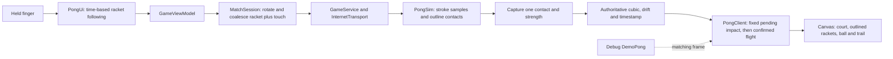

```mermaid
sequenceDiagram
    participant UI as Finger / PongUi
    participant Session as MatchSession
    participant Sim as Backend PongSim / debug DemoPong
    participant View as PongClient
    UI->>Session: eased bat + raw touch target
    Session->>Sim: match:paddle (release flushes pending held input)
    Sim->>Sim: eligible swept contact: capture rim position + strength once
    Note over Sim: Later packets keep moving the bat, not the impact
    Sim->>Sim: physics tick consumes captured impact
    Sim-->>View: match:pong with authoritative hit and cubic
    View->>View: clear fixed contact preview; draw server flight
    Note over Sim,View: Outgoing bat overlap cannot restart or drag the flight
```

## Natural voice and dictation (2026-10-19)

`SpeechViewModel` owns both speech sessions and scopes delivered text to the
active account/conversation. UI renders StateFlows and handles permission and
the optional external recognition Activity. `SpeechRepository` uses the existing
Retrofit/BearerInterceptor client; no extra socket, dependency or endpoint.
The owner-supplied Speech (2.0.6) contract is the authority pending publication
in sibling `docs/API-CONTRACT.md`.

```mermaid
sequenceDiagram
    participant U as LetterViewer
    participant V as SpeechViewModel / LetterNarrator
    participant R as SpeechRepository / authenticated API
    participant P as AndroidNarrationAudio / MediaPlayer
    U->>V: Read letter (connectionId, messageId)
    V->>P: Transient media/speech audio focus
    V->>R: GET /api/connections/{id}/messages/{id}/narration?part=0
    R-->>V: Cached Ogg + X-Narration-Part / X-Narration-Parts
    V->>P: Open file off main; prepareAsync; play
    loop Until final part
        V->>R: Fetch part n+1 while n plays
        R-->>V: Next cached part
        V->>P: Prepare; setNextMediaPlayer(next)
        P-->>V: Completion; promote linked player
        V->>R: Delete completed cache file off main thread
    end
    opt Network / 503 / 504
        V->>P: Release natural players; device TextToSpeech
        V-->>U: Natural voice unavailable, using device voice
    end
    U->>V: Pause / resume / stop / dismiss
    Note over V,P: ON_STOP (except rotation) and focus loss stop; release and delete cache files
```

`LetterNarrator` is a JVM-testable state machine with a fakeable API and audio
adapter. It prepares at most the current and next player, ignores rapid loading
taps and retired callbacks, and cancels pending HTTP/preparation on stop. The
Activity ViewModel retains playback on rotation; process restoration never
restarts audio. The native adapter uses AUDIOFOCUS_GAIN_TRANSIENT with
USAGE_MEDIA / CONTENT_TYPE_SPEECH. MediaPlayer calls stay on the main Looper;
file open/close runs on IO and `prepareAsync` does the preparation work
([Android MediaPlayer reference](https://developer.android.com/reference/android/media/MediaPlayer)).
Device TTS has no platform pause API and
resumes from its latest reported word boundary or completed chunk.

```mermaid
sequenceDiagram
    participant U as Chat / DictationBar
    participant V as SpeechViewModel / SpeechTranscriber
    participant M as MediaRepository (dictation owner)
    participant R as SpeechRepository / authenticated API
    U->>V: /audio + existing RECORD_AUDIO permission
    V->>M: Start separate AAC/MPEG-4 cache recording
    V-->>U: Timer + first-use DevicePreferences language hint
    U->>V: Stop and transcribe (or 120-second limit)
    V->>M: Stop; obtain temporary clip
    V->>R: POST /api/transcribe (raw audio/mp4, <= 3 MB)
    R-->>V: text, language, durationMs
    V->>M: Delete temporary recording
    V-->>U: Append text to current draft; focus input
    opt Network / 503 / 504
        V-->>U: Using device speech recognition
        V->>M: Cancel and delete recorded file
        V->>V: Existing SpeechRecognizer / system Activity fallback
    end
    U->>V: Cancel at any time
    V->>R: Cancel pending upload
    V->>M: Release recorder and delete temp file
    Note over U,V: No message enqueue/send and no voice-note draft
```

Recorder settings are shared with voice notes, with separate ownership, cache
directory and 120-second / 3 MB caps. FeatureViewModel's voice-note cleanup cannot
release a dictation recording. Cancel waits for in-flight recorder work before
another dictation session starts; generation tokens reject late native/API
results. HTTP cancellation closes a streaming narration body; all cache I/O is
off main. Only successful text reaches ChatViewModel's draft append helper.
No letter text is sent to the narration endpoint.

### Xiaomi checklist

- [ ] Short and long letters read fully; near-gapless part handoff.
- [ ] Pause/resume/stop, close stops audio, rapid taps no overlap, rotation.
- [ ] Airplane mode -> device voice fallback; background/focus loss stops audio.
- [ ] `/audio` records and transcribes Indian-English into the composer without sending.
- [ ] Cancel recording/upload; silence -> "Didn't catch that. Try again."
- [ ] Two-minute timer/limit; first-use hint persists; device fallback remains cancellable.
- [ ] Voice notes unaffected, reciprocal recording guard; light/dark and TalkBack.

## Mini-games — ephemeral two-player relay (2026-10-19)

`/games` is a composer command, never a message type. `GameViewModel` owns
invitations, engines, results and timers. `GameService` sits beside MessageService
and reads its active account/conversation and presence. All five acknowledged
events pass through Transport -> InternetTransport -> the existing RealtimeSocket.
No extra socket, push notification, REST endpoint, Room row or server persistence.
The authority is sibling `docs/API-CONTRACT.md` §10, Games relay.

```mermaid
sequenceDiagram
    participant A as Inviter UI / GameViewModel
    participant GA as GameService / Transport / InternetTransport
    participant S as Shared RealtimeSocket / backend relay
    participant GB as Partner transport / GameService
    participant B as Partner GameViewModel / UI
    A->>GA: UUID + gameInvite(gameId, game)
    GA->>S: game:invite {gameId, game} + ack
    S->>GB: game:invite + from
    GB->>B: In-chat invitation (30 s expiry)
    B->>GB: Accept
    GB->>S: game:accept {gameId} + ack
    S->>GA: game:accept + from
    GA->>A: Start as player 1
    loop Board moves or 29.4 Hz table tennis packets
        A->>GA: Validate local move; seq + data
        GA->>S: game:move {gameId, seq, data} + ack
        S->>GB: game:move + from
        GB->>B: Validate sender, gameId, sequence, turn and rules
        Note over A,B: Same pure Kotlin rules on both phones; illegal/order errors end the game
    end
    A->>GA: Resign / leave / cancel / invalid move
    GA->>S: game:end {gameId, reason} + ack
    S->>GB: game:end + from
    GB->>B: Clear play state; show result
```

Board games use a single sequence starting at zero across both players; dots
retains the player's turn on a completed box. Table tennis has a sequence per
sender: host physics at display rate, 34 ms packet interval, bounded guest
extrapolation with smoothing, substep paddle collisions and a three-second serve.
The host waits for acknowledgement of the final-score packet before its result.
The guest starts transmitting only after accept is acknowledged. Both validate
finite court coordinates, paddle limits, score progression and envelope ordering.
Game packets are never retried after uncertain delivery: a lost relay pauses for
15 seconds then ends, preserving strict duplicate/out-of-order rejection.

Chess uses chesslib 1.3.7, with generated legal-move membership checked before
`doMove`. Check, castling, en passant, all promotions, mate, stalemate, repetition,
50-move and material draws are local. Original themed vectors represent pieces.
Licenses and upstream attribution ship under `assets/licenses`; see
[THIRD-PARTY-LICENSES.md](THIRD-PARTY-LICENSES.md).

The activity's Hilt ViewModel survives rotation; SavedStateHandle records the
game ID, role, game kind and account/conversation scope. Restoring a process never
restores an incomplete board: it ends the old game once the shared socket returns.
A different account/conversation discards the saved game. Retired IDs reject late
accepts/moves; simultaneous invites converge on the smaller UUID. Rematches use a
new UUID; tic-tac-toe results offer a local best-of-three tally over rematches,
without adding undocumented relay fields. Leaving chat/backgrounding pauses play.
The full-screen Compose surface owns KEEP_SCREEN_ON only while playing and stays
below the existing incoming-call overlay. Theme tokens,
original vector icons, Canvas boards and semantic controls serve light/dark mode;
turn text announces changes and table tennis offers TalkBack paddle actions.

### Xiaomi checklist

- [ ] `/games` blocked when partner offline (including `partner_offline` ack).
- [ ] Invite, accept, decline, cancel and 30-second invitation timeout.
- [ ] Each of the 5 games played to a result (chess special moves/draws included).
- [ ] Rematch uses a fresh game; tic-tac-toe best of 3 and score tally.
- [ ] Resign and leave mid-game; Back asks before leaving.
- [ ] Partner kills app mid-game -> pause, then end after 15 seconds.
- [ ] Rotate mid-game on both phones; process kill/relaunch ends the old game.
- [ ] Table tennis smooth on mobile data and Wi-Fi; countdown, paddle drag, first to 7.
- [ ] Light and dark mode, large text, TalkBack cell/line controls and turn announcements.
- [ ] Screen stays awake while playing and returns to normal after leaving.
- [ ] An incoming call remains visible and answerable over a game.

## Instant leave, zip export, server gates, instant receipts (2026-10-19)

Contract §10 (backend PR #109, merged). Gates: `GET /api/me` timestamps are truth;
`AccountRepository.syncGates` caches them per JWT `sub` in DevicePreferences and
pushes a same-account device answer up once via `POST /api/me/gates` (an older
backend or offline keeps the cache). Leave is one call (`POST /leave`); the old
step routes/fields are gone (JSON stays tolerant via `ignoreUnknownKeys`).
`ConversationArchive.kt` streams a zip (letters via `writeLetterPdf`, attachments
signed 50 at a time and copied in 64 KiB chunks, then `conversation.html/.txt`);
deleted and system rows are excluded and deleted media is never fetched. The
partner of an ended connection routes to `PartnerLeftScreen` from `/current`
(cold start safe), the socket `connection:ended` event or the `connection_left`
push. Reads go `MessageService -> Transport -> InternetTransport` as socket
`message:read` with a 2 s ack, REST fallback; FCM message pushes call
`MessageService.markDelivered` (1 s debounce) -> `POST /delivered`.

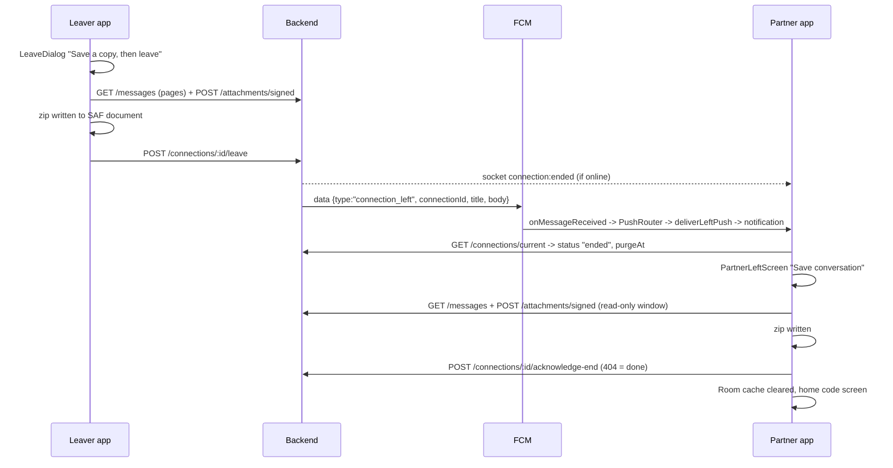

## Letter pagination, dictation, swipe (2026-10-19)

`writeLetterPdf` measures the letter at a font size, `chooseLetterSize` picks the first
size that fits one page, and `planLetterPages` keeps the signature with the last body
lines. `/audio` is handled in ChatScreen's `runCommand` and never reaches MessageService.
`replySwipe` claims the pointer only for a clearly horizontal drag.

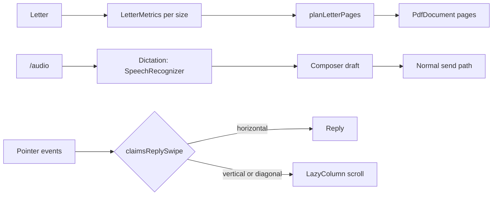

## Live presence (2026-10-19)

InternetTransport carries `{userId, online, lastSeenAt}` on the existing socket.
MessageService sends foreground state on visibility changes/reconnect and clears
partner state on disconnect/session teardown. The header prefers a snapshot,
retaining receipt fallback when none exists and own-network status priority.

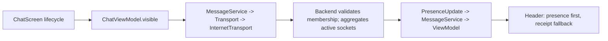

## A0 — implemented scaffold

Single app module, single exported Activity, Kotlin + Compose + Material 3,
Navigation Compose and Hilt. The only route is `welcome`; no auth, message,
push-token or call work is started. Incoming Activity extras are not consumed.
Firebase Messaging auto-init is disabled until A3. Backup is disabled because
later milestones store account/session/message state locally.

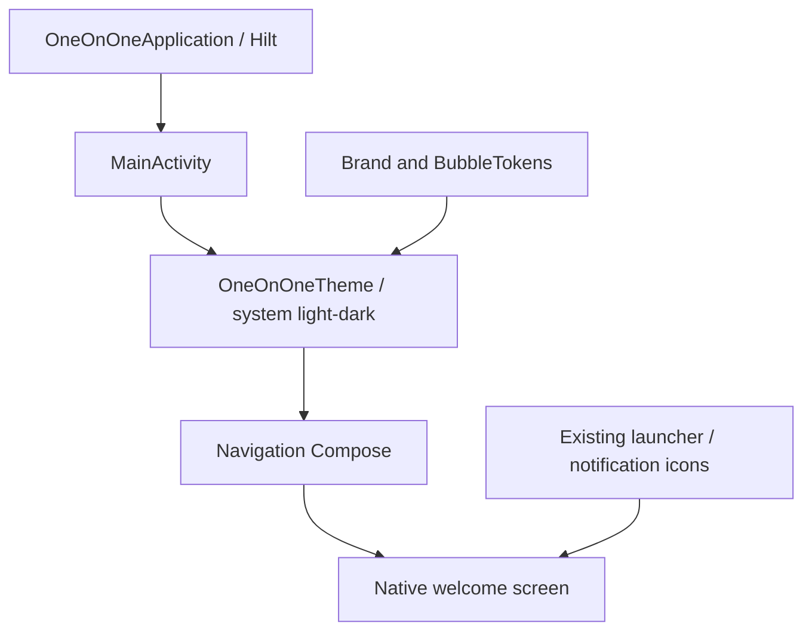

`ui/theme/BubbleTokens.kt` mirrors the entire web architecture token table dated
2026-10-07: dark, light, love and samurai; mine/other gradient stops, tails, text,
metadata, edges, sent ticks and read ticks. Wallpaper palettes apply in both
themes. Background gradients use 135 degrees when chat arrives in A2/A6.
The dark brand is green `#7ee787`, blue `#79c0ff`, background `#0d1117`;
system light mode uses readable green/blue accents without dynamic color.

## Required message boundary — planned for A2, not implemented in A0

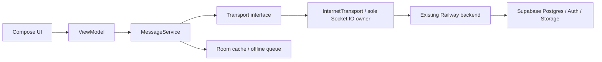

Every send, receive, reaction and call signal must stay behind the transport
boundary. REST repositories use Retrofit/OkHttp; Supabase Auth tokens authorize
REST and socket handshakes. The server validates identity, membership, status and
message payloads. Room is a cache, never an authorization source. A0 has no fake
repository, fake transport or backend implementation. No Bluetooth transport is
in scope.

## Build configuration and identity

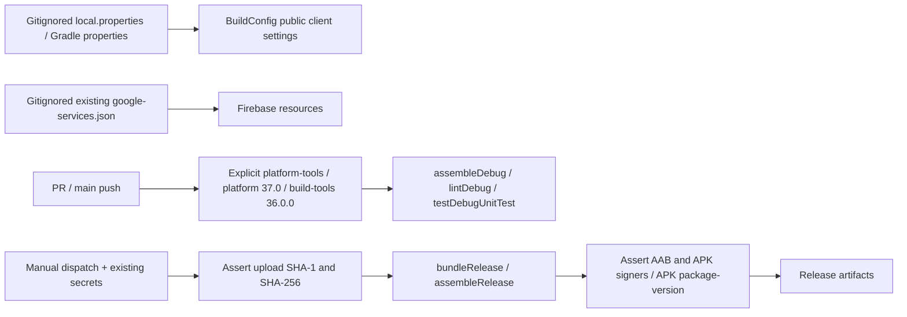

`app.web.oneonone`, minSdk 26, target/compile 37, versionCode 5 by default.
Signing is the unchanged upload identity; no key-generation path exists. Secret
files are scrubbed in CI. The API snapshot in this repo is copied verbatim from
the web repo; future changes must use the authoritative web contract, not infer
behavior from client code. No backend deployment or schema change is part of A0.

### A0 CI setup correction

Both debug and release jobs explicitly install platform-tools, platform 37.0
and build-tools 36.0.0. setup-android v3's default also asks for the removed
legacy `tools` package, so using its default fails before Gradle starts. The
explicit package list keeps the checks and release job on the same SDK/toolset.

## A1 — auth, gates and account state

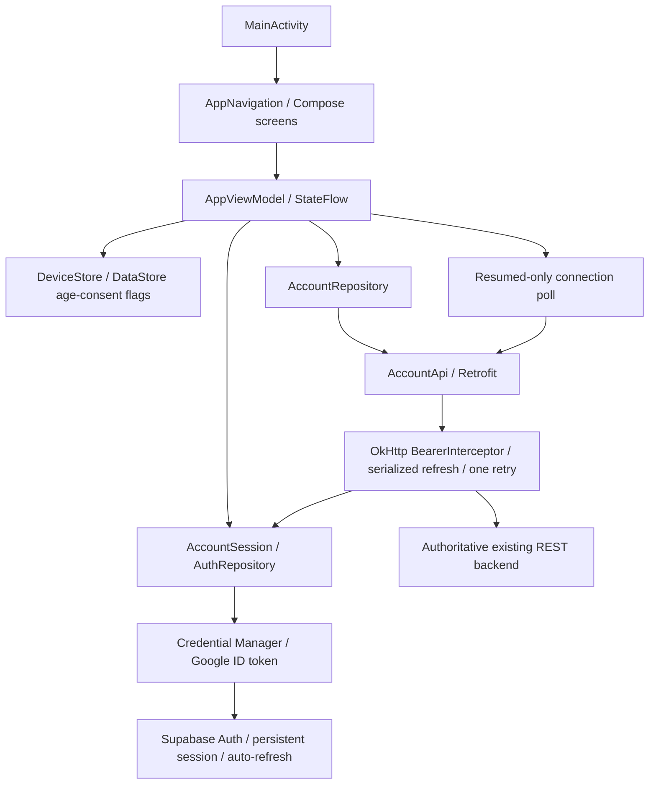

Navigation owns home, settings and blocked accounts. Home reflects a single
server-derived boot route; the age/consent gate comes before account screens.
On sign-out, protected back-stack screens are discarded. Date of birth is used
only in the UI; DataStore saves age verification and acceptance time, matching
the web's per-device rules. Connection state is not persisted as authorization.

Small AccountSession/DeviceStore interfaces allow JVM ViewModel/repository tests
without a Credential Manager/Android storage runtime. Supabase SDK session storage
and auto-refresh are reused; there is no custom token store. The interceptor runs
on OkHttp workers, never the main thread, and serializes only rejected-token
refreshes. An old request cannot invalidate a newer signed-in session. Push token
storage/unregister is wired now; actual registration and lifecycle arrive in A3.

This milestone consumes only the contract's me/current/request/accept/decline/
cancel/blocks/unregister/deletion routes. A2 will replace the chat placeholder and
introduce the frozen RealtimeSocket and rendering/call-launch seams, superseding
the old A0 diagram's sole-socket-owner label with RealtimeSocket.

## A2 — chat, durable queue and frozen realtime seam

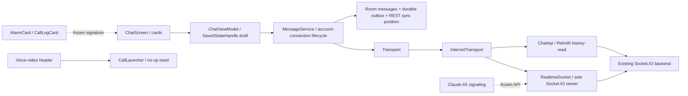

The A0 diagram's socket ownership label is superseded: only RealtimeSocket creates
Socket.IO, InternetTransport consumes it, and every message path remains behind
MessageService/Transport. A singleton application IO scope owns the active
conversation; per-conversation supervised collectors are cancelled and joined on
change/sign-out. The socket stays connected in background until teardown; the UI's
resumed-chat flag controls mark-read (A3 will also use it for notification suppression).
Call consumers share the same singleton rather than creating another socket.

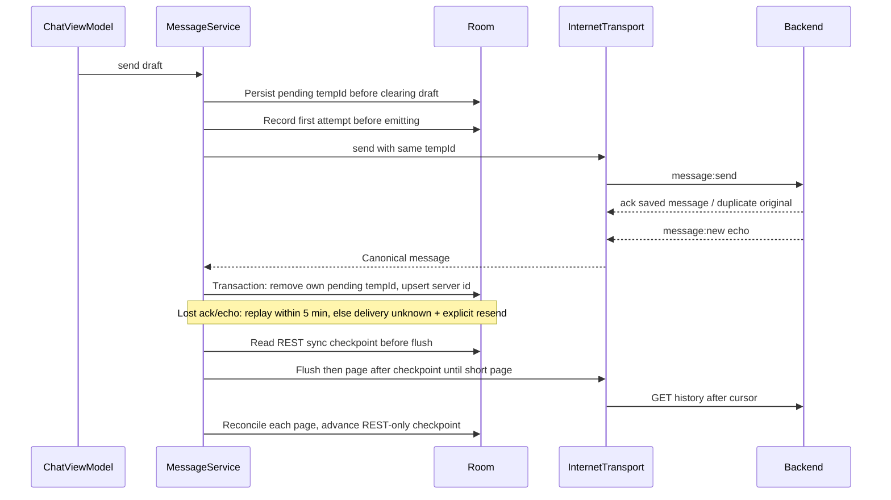

Room v1 has composite owner/connection/message keys and a separately persisted
REST watermark. Incoming/ack timestamps never advance it; otherwise an ack during
reconnect could skip missing older messages. Server timestamps are normalized to
fixed-width UTC only for SQLite sort columns; message bodies preserve wire values.
History replaces reactions authoritatively; a delayed tempId ack preserves newer
cached reaction changes. Room/cache/receipt flags do not grant membership.

Frozen public APIs and exact placeholder file ownership are listed in PROGRESS.
Claude may replace the CallLauncher binding and both cards, and add A4/A5 lifecycle
consumers without changing the message pipeline or opening another socket.

## A3 — data-only push and background work

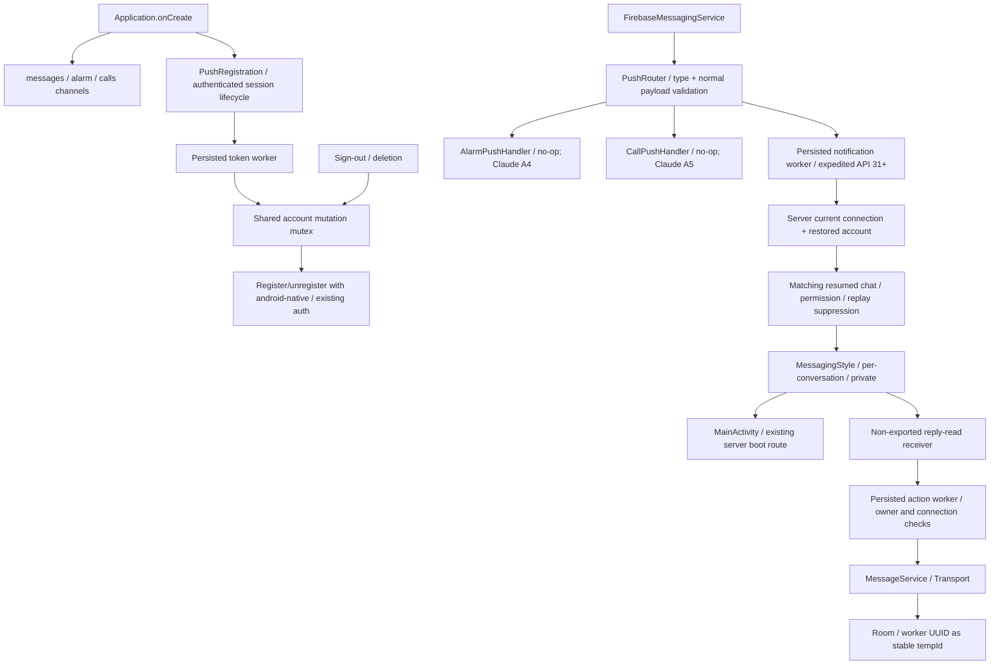

FCM callbacks do no slow network work; WorkManager keeps token/notification/action
work alive across process loss. API 31+ notification jobs are expedited; older APIs
use normal work without introducing an A3 foreground service. Server membership is
checked before posting/action execution. A delayed push cannot target a different
current conversation, and notification actions name a captured auth subject as well
as the conversation. MainActivity consumes no untrusted push authorization extras.

Reply work uses its immutable WorkRequest UUID as tempId. Enqueue first checks the
scoped Room alias; REST history preserves that alias on a canonical row, so worker
retries recognize already-acknowledged sends. The A2 five-minute uncertainty policy
still applies. Registration stores a candidate before HTTP and shares a mutex with
sign-out; in-flight registration finishes before token cleanup/session removal.

The three handler methods and exact PushHandlersModule path are frozen for Claude.
Message notifications never invoke an alarm or call implementation. The existing
notification-block missed-call fallback remains a generic no-action notice.
Proprietary OEM activities are unverified best-effort entry points with native
Settings/App info fallback; optional permission settings never gate account/chat use.

## A6 — structured features, private media and export

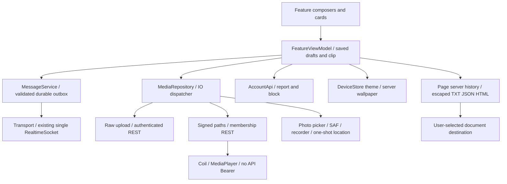

Structured features reuse ordinary immutable messages and replyTo rather than a
second state protocol. Contract validators run before Room enqueue. Ask/pick reply
attribution follows the original author. Alarm and call rendering/entry/push seams
remain frozen for Claude. No second socket or transport is constructed.

Media ownership is the current app user and connection; uploads and location
re-check that scope after asynchronous work. Completed voice clips survive config
changes/process restoration in private cache, while live recording and playback
stop at background/navigation. FileProvider exposes only `cache/shared`, never the
cache root or arbitrary paths. Unauthenticated media/map clients do not carry REST
credentials. Signed paths are server-authorized; storage URLs require HTTPS and the
configured Supabase host. Static photos strip EXIF by pixel re-encoding with a 4 MP
memory ceiling. Voice uses media audio focus and leaves call routing/mode alone.

Coil's official GIF/cache-control extensions share the pinned Coil version. The
custom client identifies the app for OSM and honors HTTP caching. Map tiles are
requested only when their cards are composed; no offline maps or tile prefetch.
Themes are per-device, wallpapers shared, and legacy line style renders bubbles
as the reference currently does. Export pages existing REST history and escapes
all HTML content; it includes attachment metadata rather than permanent media URLs.

## A7 — shrinker and release gates

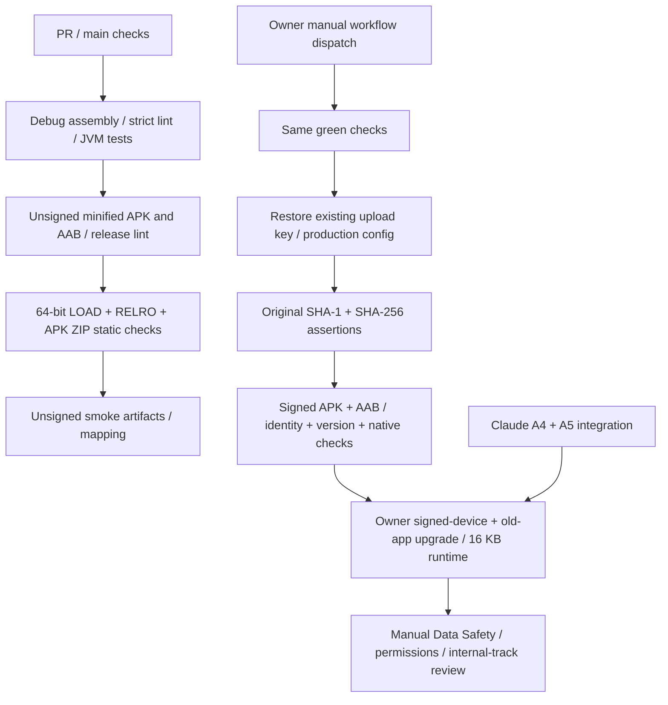

R8 keeps dynamic protocol/engine and WebRTC JNI boundaries with consumer rules
for Android/framework DI/serialization/database/background work. Two exact Ktor
JMX warnings are excluded because the pinned detector catches their absence on
Android; all other unresolved dependencies fail the build. Mapping is retained.
Resource shrinking and dependency ART profiles are enabled without claiming a
measured app baseline profile or authenticated runtime verification.

The native checker examines actual ELF64 headers for arm64-v8a/x86_64 in APK/AAB
and verifies stored APK entry offsets. RELRO is checked against writable segment
ranges rather than rejecting safe whole-LOAD endpoints solely for a nonzero
modulo. This static evidence doesn't replace a final 16 KB runtime test. See the
[Android linker source](https://android.googlesource.com/platform/bionic/+/main/linker/linker_phdr.cpp)
and [page-size guidance](https://developer.android.com/guide/practices/page-sizes).

Unsigned smoke artifacts and any local debug-signed minified copy are separate
from manual CI's real upload-key artifacts. Signed CI still verifies the original
certificate and Firebase/package/version assertions; it never uploads to Play.
Final release requires Claude's reserved features plus owner phone/Console gates.
The release checklist is a Data Safety draft grounded in current native behavior
and the web privacy/API references, with final SDK/provider/call review explicit.

## Emergency alarm (A4)

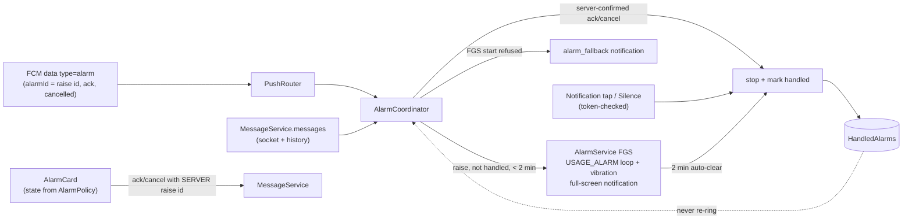

## Calls (A5)

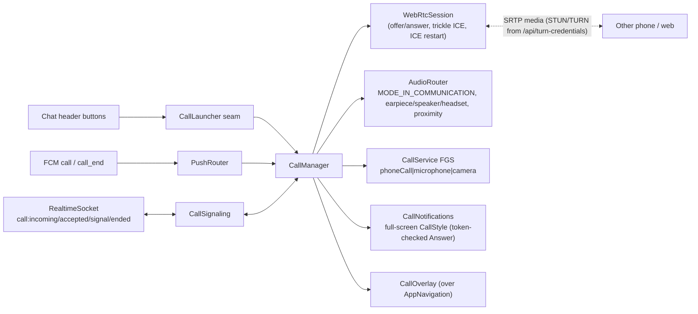


## Design system (S1)

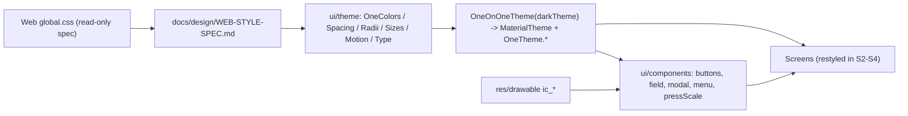


## Chat screen composition (S2)

```mermaid
flowchart TB
  CS["ChatScreen (state + ViewModel wiring, unchanged behaviour)"] --> H["ChatHeader / ChatMenu / ChatSearchBar / LeaveBanner"]
  CS --> Log["LazyColumn (max 720dp)"]
  Log --> MB["MessageBubble"]
  MB --> G["isGroupStart (BubbleGrouping)"]
  MB --> TM["TextWithMeta (custom Layout, meta on last line)"]
  MB -. "card slot + LocalBubbleColors" .-> Cards["FeatureCard / AlarmCard / CallLogCard (S4)"]
  CS --> SM["SlashMenu (slashMatches)"]
  CS --> RB["ReplyBar"]
  CS --> CC["ChatComposer (pill, send / mic)"]
```

## Presence and launch (D2)

```mermaid
flowchart LR
  Visible["Resumed chat"] --> Heartbeat["MessageService: read every 10s, skip recent reads"]
  Heartbeat --> Transport["Transport.markRead / existing REST read"]
  Receipt["Connection.otherLastReadAt + receipt:update"] --> Newest[newerTime]
  Newest --> Presence["Pure label formatter + resumed 5s ticker"]
  Socket["Own socket state"] --> Presence
  Presence --> Header["Pure ChatHeader / crossfade"]
  Starting["Starting theme / inset launcher logo"] --> Splash["Loading route; keep splash at most 3s"]
  Splash --> Loading["Same centered logo / dark background"]
  Loading --> App["Server-driven app route"]
```

Presence uses the existing receipt timestamp, with a strict 15-second freshness
window; socket trouble overrides the other member's status. Immediate message
reads and tick rendering retain their existing behavior. Heartbeat freshness
uses monotonic time and stops when paused or deactivated. The loading screen
bypasses ScreenFrame's text, progress and entry animation for a seamless launch.

## Attachment cards and viewers (D3)

```mermaid
flowchart LR
  Card[FeatureCard] --> Play["FeatureViewModel / MediaPlayer"]
  Play -- "position every 100ms; pause/resume" --> Voice["Compact voice card / filled track"]
  Card --> Download["Existing openFile / MediaGateway.download"]
  Download --> URI["Private cached content URI"]
  URI --> Viewer[DocumentViewer]
  Viewer --> PDF["PdfRenderer / serialized IO / visible pages only"]
  PDF --> Pixels["Screen-width bitmaps / recycle off-screen"]
  Viewer --> Text["UTF-8 text / 1 MiB cap / lazy bounded rows"]
  Viewer --> Office["Open with chooser / temporary URI read grant"]
  Photo["Tap photo"] --> Zoom["Full-screen PhotoViewer / bounded pinch + double tap"]
  Menu["Voice bubble long-press menu"] --> Save["Existing CreateDocument / saveAttachment"]
  Viewer --> Save
  Zoom --> Save
  Card --> Save
```

Viewer dialogs use a black surface and safe system-bar insets. PDF open/render/
close runs off the main thread; one mutex coordinates page access and disposal,
and closing the renderer also closes its descriptor. Only visible PDF rows own
bitmaps. Text reads at most 1 MiB plus one byte to detect truncation; lazy rows
also bound the layout work for very long lines. Voice cards register their save
callback with the containing bubble's existing menu, without adding ChatScreen
callbacks. No endpoint, payload, attachment authorization or cache boundary changes.
### Navigation routes (D4)

```mermaid
flowchart LR
  Home["home (boot route / ChatScreen)"] -->|menu: Settings| Settings
  Home -->|menu: Account| Account
  Settings --> Account["account"]
  Settings --> Notif["notifications"]
  Account --> Blocks["blocks"]
  Onboard["auto: notifications?first=true"] -.-> Notif
```

`settings`, `account`, `blocks` and `notifications` share `SettingsScaffold`.
Appearance/Export dialogs are hosted by the `settings` route (chat connection only).

### Chat scroll pinning and search (2.0.1)

```mermaid
flowchart TD
  Open["open chat / cache + server load"] --> Grow
  Kbd["keyboard opens (viewport shrinks)"] --> Grow
  Img["image / card grows"] --> Grow
  Grow["canScrollForward becomes true"] -->|pinned, not scrolling, no query| End["scrollToEnd(): last item + scroll rest of tall bubble"]
  Focus["composer focused"] -->|pinned = true| End
  NewMsg["new last message"] -->|mine, or near bottom and no query| End
  UserScroll["user scroll ends"] --> Pin{"at bottom?"} -->|yes| Pinned["pinned = true"]
  Pin -->|no| Unpinned["pinned = false"]
  Query["search query"] --> Matches["searchMatches(messages, query)"] --> Current["current = newest; ▲ -1 / ▼ +1 wrap"]
  Current --> Jump["animateScrollToItem(index + 1, -viewport/3)"]
  Matches --> Mark["MessageBubble highlight: matchRanges spans + current-match border"]
```

Search is client-side over loaded messages only; the full log stays visible.

### Pre-chat flow and gates (2.0.2)

```mermaid
flowchart TD
  SignIn["Continue with Google"] --> Age["Date of birth (inline wheel)"] --> Consent["Terms"] --> Connect
  Connect["Your connection ID: copy / new ID"] -->|I have their ID| Enter["Enter their ID: paste, connect"]
  Enter -->|Back| Connect
  Enter -->|request| Waiting["Request sent"]
  Connect & Waiting & Request["Connection request"] -->|Sign out| Out["AccountRepository.signOut / deleteAccount"]
  Out -->|resetGates| SignIn
  Request -->|accept| Chat --> Notif["notifications?first=true (first chat open only)"]
```

### Chat notices and alarm limit (2.0.2)

```mermaid
flowchart LR
  Raise["send alarm raise"] --> Recent{"own raise in last 3 min?"}
  Recent -->|yes| Refuse["IllegalStateException: wait notice"]
  Recent -->|no| Queue["outbox → InternetTransport"] --> Ack{"server ack"}
  Ack -->|rejected| Drop["store.discard + wait notice"]
  Ack -->|IOException| Queued["stays queued"]
  State["connectionState ≠ Connected for 2s"] --> Pill["top pill: No connection · Reconnecting…"]
  Errors["chat / feature / account error"] --> Toast["bottom pill, 4s"]
```

### Message gestures and selection (chat polish, 2026-10-14)

```mermaid
flowchart LR
    T[Tap] --> Q{Where?}
    Q -->|link / number| O[Open]
    Q -->|reply quote| J[Jump to original]
    Q -->|selection mode| S[Toggle selection]
    Q -->|elsewhere| X[Show timestamp]
    D[Double tap] --> R[ReactionBar popup<br/>not focusable] -->|reaction:add / remove| MS[MessageService]
    L[Long press] --> LQ{On link?}
    LQ -->|yes| C[Copy link / number]
    LQ -->|no| S
    S --> SB[SelectionBar: reply · copy · save · report]
```

### Emergency alarm in the open chat (2026-10-14)

```mermaid
sequenceDiagram
    participant FCM as FCM / socket
    participant AC as AlarmCoordinator
    participant AS as AlarmService
    participant UI as ChatScreen
    FCM->>AC: raise
    AC->>AS: ring (sound + full-screen)
    Note over UI: notification tap opens chat, ring continues
    UI->>UI: live raise from them: red glow + banner
    UI->>FCM: Acknowledge = alarm ack (contract)
    FCM-->>AC: server-confirmed ack
    AC->>AS: stop
```

### Edit / delete / pin / typing / link previews (2026-10-14)

```mermaid
flowchart LR
    UI[ChatScreen] --> VM[ChatViewModel] --> MS[MessageService] --> T[Transport] --> IT[InternetTransport]
    IT -- "message:edit / message:delete / message:pin / typing" --> S[(Socket.IO)]
    S -- "message:update" --> IT -->|reconcile| R[(Room cache)]
    S -- "pin:update / typing" --> IT --> MS
    IT -- "GET /api/link-preview" --> API[Backend unfurl<br/>SSRF-guarded]
    API -->|title + base64 image| MS -->|cached per URL| UI
```

### Alarm "Silence" = acknowledgment, message push delivered inline (2026-10-14, round 2)

```mermaid
sequenceDiagram
    participant FCM
    participant MS as OneOnOneMessagingService
    participant AC as AlarmCoordinator
    participant AS as AlarmService
    participant Svc as MessageService
    FCM->>MS: message push
    MS->>MS: deliverMessagePush (≤8 s, in the FCM window)
    MS-->>MS: on failure/timeout: MessageNotificationWorker (retry)
    FCM->>AC: alarm raise
    AC->>AS: ring (quiet channel if the chat is open: banner is the ack UI)
    AS-->>AC: FGS refused: insistent backup notification; full-screen tap promotes it to a real ring
    Note over AS: user taps Silence on the notification
    AS->>AC: silenced(alarmId) → HandledAlarms.pendingAcks
    AC->>Svc: send alarm {ack} (temp id silence-<id>) once a chat session is active and the raise is still Live
```

### GIPHY GIFs and profile photos (2026-10-14)

```mermaid
flowchart LR
    Sheet[ComposerEmojiSheet · GIFs] --> FVM[FeatureViewModel] --> MG[MediaRepository]
    MG -- "GET /api/gifs" --> BE[Backend gifService] -- "API key (server env)" --> G[(GIPHY API)]
    MG -- "POST /connections/:id/gifs {id}" --> BE -- "fetch *.giphy.com, GIF magic, ≤10 MiB" --> ST[(private attachments bucket)]
    BE -->|"{path, mime, size, width, height}"| MG --> MS[MessageService.send type=image]
    Settings[Settings · Your photo] --> PVM[ProfileViewModel] -- "PUT/DELETE /api/me/avatar" --> BE2[avatarService] --> ST
    PVM -- "GET /api/me/avatars (yours + live partner only)" --> BE2
    Header[ChatHeader] -->|"PartnerPhoto (device-only) → otherAvatar → initial"| PVM
```

### Sticker maker and account library (2026-10-14, Prompt 1)

The third composer tab uses the existing theme and inherits ProvideChatTextScale.
PickVisualMedia supplies a content URI; StickerViewModel retains the URI permission,
mode and normalized crop in SavedStateHandle. Decode applies the existing EXIF
orientation helper and bounds the longer side to 1024 px. CPU segmentation,
pixel re-encoding and file/index work run off the main thread. A missed subject or
segmenter failure keeps Original available and explains the fallback.
MediaPipe owns a private input bitmap copy; closing MPImage cannot recycle the
Original bitmap still displayed by the maker.

```mermaid
flowchart LR
    Sheet[ComposerEmojiSheet · Stickers] --> SVM[StickerViewModel / saved URI-mode-crop]
    SVM --> Picker[PickVisualMedia / private bounded pixels]
    Picker --> Segment[MediaPipe CPU / bundled DeepLab-v3]
    Segment --> Crop[Original or Cut-out / normalized square crop]
    Crop --> WebP[512×512 alpha WebP / quality 100 to 80 / ≤100000 bytes]
    SVM --> Library[StickerLibrary / atomic JSON and WebP files]
    Library --> Files[filesDir/stickers/ownerId]
    Account[AccountRepository sign-out or deletion] --> Lock[Shared AccountMutationLock]
    SVM --> Lock
    Lock --> Clear[Clear index and files before removing credentials]
    Sheet --> FVM[FeatureViewModel.sendSticker]
    FVM --> Media[MediaGateway.uploadSticker / raw image-webp attachment]
    FVM --> MS[MessageService / normal image payload and replyTo]
    MS --> Transport --> InternetTransport
```

The JSON index contains id, createdAt, lastUsedAt, favourite, a display title and
an optional local pack name. Favourites and My stickers sort newest first; Recent
contains the last 16 used, with deterministic ties. One original six-vector pack,
Little signals, is rendered to WebP on an account's first library load. Deleting a
built-in is persistent because an existing empty index is never reseeded. Account
mutations and library edits share the same lock, with signed-in owner checks, so a
late save cannot recreate files after sign-out. Cleanup follows successful push
unregistration or successful server account deletion; failed requests preserve data.
Malformed indexes are reported without overwriting them.
Indexes have a 1 MiB ceiling, checked before writing; approaching a few thousand
stickers would justify replacing JSON with Room.

Sticker uploads validate the private file scope, WebP format, 512×512 dimensions,
100000-byte cap and server response. The attachment endpoint and message payload
remain exactly contract §2/§4: type image, {path, mime, size, width, height}.
The ordinary photo uploader still strips EXIF; the already-encoded sticker File
path preserves alpha. Received images and delete-for-everyone use existing behavior.

#### Background-removal choice, licence and attribution

Decision: the only added dependency is com.google.mediapipe:tasks-vision:1.1.0,
using the bundled float32 DeepLab-v3 v1 model on CPU. First-use segmentation works
without Play services or a model download. No photo is sent for segmentation.
This accepts a larger APK to meet the strict offline requirement.

| Comparison | MediaPipe Image Segmenter + DeepLab-v3 | ML Kit Subject Segmentation |
| --- | --- | --- |
| People | Person is a supported category. The 257×257 confidence mask is enlarged with filtered soft alpha; fine hair needs device review. | Designed to isolate prominent people, including multiple subjects and separate subject masks. |
| Pets | The bundled labels include cat, dog, bird, cow, horse and sheep. Fur and small subjects need device review. | Designed for prominent pets as well as people. |
| Objects | Fixed VOC categories such as bottle, chair, vehicle and plant; unrecognized objects may need Original. | Designed for prominent objects, without this app's fixed VOC label filter. |
| Licence | SDK and TensorFlow model: Apache-2.0; attribution and licence bundled below. | Google APIs Terms of Service plus ML Kit terms; models are related software under those terms. |
| Size and availability | Model: 2,780,176 bytes plus SDK native libraries; actual universal debug APK delta is in PROGRESS. | Google's documented app increase is about 200 KB; its model must first be downloaded through Play services. Inference is local afterward. |

This is a comparison of documented capabilities and expected limitations, not a
measured head-to-head quality result. People, pet fur and object edge quality on
Xiaomi hardware remain in the device checklist.

Sources: [MediaPipe models and categories](https://ai.google.dev/edge/mediapipe/solutions/vision/image_segmenter),
[Android execution guide](https://ai.google.dev/edge/mediapipe/solutions/vision/image_segmenter/android),
[TensorFlow model catalogue and licence](https://www.kaggle.com/models/tensorflow/deeplabv3),
[MediaPipe licence](https://github.com/google-ai-edge/mediapipe/blob/master/LICENSE),
[ML Kit subject capabilities](https://developers.google.com/ml-kit/vision/subject-segmentation),
[ML Kit installation and size](https://developers.google.com/ml-kit/vision/subject-segmentation/android),
[ML Kit terms](https://developers.google.com/ml-kit/terms).

Attribution: MediaPipe Authors and TensorFlow Authors. The pinned model is
[DeepLab-v3 float32 v1](https://storage.googleapis.com/mediapipe-models/image_segmenter/deeplab_v3/float32/1/deeplab_v3.tflite),
SHA-256 ff36e24d40547fe9e645e2f4e8745d1876d6e38b332d39a82f0bf0f5d1d561b3.
The APK includes stickers/APACHE-2.0.txt and stickers/NOTICE.txt alongside the model.
Little signals' love, star, wave, cat, sprout and moon paths were drawn specifically
for this change; no third-party artwork is used.

[WhatsApp/stickers](https://github.com/WhatsApp/stickers) was reviewed as a
third-party pack-app reference under its
[BSD-3-Clause licence](https://github.com/WhatsApp/stickers/blob/main/LICENSE).
Only the square 512 px and small WebP sizing concepts informed this in-app library.
Its 96 px tray icon is a WhatsApp pack-provider convention and is not needed here.
No WhatsApp code, artwork, content provider or integration is included.

## Sticker/photo rendering and instant media sends (2026-10-14, 2.0.4)

Built-in packs: Little signals and Cats (original vector drawings, rendered to WebP on first
library creation) and Craftwork "Open Stickers" IT / Life / Nature / Shapes (owner holds a paid
Craftwork licence; pre-encoded 512×512 WebP in `assets/stickers/packs`, copied as-is).
Maker gains a free crop box (`StickerTrim`) applied before the square placement (`StickerCrop`).

```mermaid
flowchart LR
  Tap[Sticker tap / voice stop / GIF tap] --> P[FeatureViewModel.pending += item]
  P --> UI[ChatScreen: PendingMediaBubble at list end]
  P --> Up[MediaGateway upload]
  Up --> Send[MessageService.send -> Transport -> InternetTransport]
  Send --> Done[pending -= item; real message replaces the placeholder]
```

```mermaid
flowchart TD
  M[image message] --> S{512x512 image/webp and no reply quote?}
  S -- yes --> St[Bare sticker 150dp + bubble-coloured time pill under its corner]
  S -- no --> Ph[Photo in a 3dp bubble frame + time/ticks scrim on the image]
  St --> Side{mine?}
  Ph --> Side
  Side -- yes --> R[bottom-right]
  Side -- no --> L[bottom-left]
```

Stickers are still ordinary `image` payloads (contract unchanged); detection by exact
512×512 WebP is a client shortcut until the optional backend sticker flag (codex Prompt 2).
All chat times use a 12-hour `h:mm a` clock in the device time zone.

## Owner feedback round (2026-10-19, 2.0.5)

Age/Terms gates are local device prefs keyed to the auth user (`gatesOwner` = JWT `sub`).
Sign-out keeps them, so the same account goes straight to the chat; another account, or a
deleted and re-created one, is asked again. Gates saved before this change are adopted by the
signed-in user on first read (sign-out used to wipe them, so they can only be theirs).

```mermaid
flowchart TD
  L[AppViewModel.load] --> T[auth.accessToken -> tokenSubject]
  T --> G{DeviceStore.gates owner matches?}
  G -- yes, both set --> C[me + current connection -> Chat]
  G -- no / missing --> A[Age -> Consent, saved with owner]
  SO[signOut] -. keeps gates .-> G
  DA[deleteAccount] -. resetGates .-> G
```

Letters render as one white A4-proportioned page in black Dancing Script (OFL, `res/font`),
date top-right, body indented, signature pinned to the page foot. "Download PDF" draws the
same layout with `PdfDocument` + `StaticLayout` (`writeLetterPdf`), breaking long letters
line by line across A4 pages. The payload still carries `appearance: "dawn"` (contract).

```mermaid
flowchart LR
  V[LetterViewer Download PDF] --> CD[CreateDocument application/pdf]
  CD --> VM[FeatureViewModel.saveLetter]
  VM --> MG[MediaGateway.saveLetterPdf, IO]
  MG --> W[writeLetterPdf: A4 pages, handwriting Typeface]
```

Selection inside cards: photo, file row and card buttons swallow the bubble's long press, so
they use `bubbleClickable` (LocalMessageSelection): long press selects the message (enables
Delete within the server's 30-minute window), taps toggle while selecting.

Incoming call: a ring posted while the app was backgrounded is replaced by a silent copy
(`CallNotifications.quietIncoming`) when the in-app ring starts, so only one ringtone plays.
Alarm: a queued ack from this device stops the local ring immediately (`AlarmPolicy.ownAcks`)
instead of after the server echo. Presence ages a live receipt by the phone's monotonic clock
(immune to server/phone clock skew) and ticks every second; truly instant online/offline needs
the backend `presence` socket event (see the [backend handoff prompt](prompts/backend-presence-prompt.md)).
This is a proposal, not the current API contract. Backend support and Android event
emission/subscription are still pending; the receipt-based fallback remains in use.

## Server-authoritative games (2026-10-20, 2.0.7)

The client no longer runs game engines over a peer relay. The backend owns every match
(contract §12); Android renders `match:state` snapshots and sends actions. The message path
rule holds: `GameViewModel -> MatchSession -> GameService -> Transport -> InternetTransport`
(only InternetTransport touches Socket.IO).

```mermaid
flowchart LR
  UI[GameHost / GameBoards] --> VM[GameViewModel<br/>stage = stageOf match, hub, dismissed]
  VM --> MS[MatchSession<br/>newest version wins, move retry by seq,<br/>paddle throttle 30/s, sync on connect]
  MS --> GS[GameService : MatchChannel]
  GS --> T[Transport.match / paddle<br/>matchStates / pongFrames]
  T --> IT[InternetTransport<br/>match:* emitWithAck, match:paddle emit]
  IT <-->|Socket.IO| BE[(Backend MatchManager)]
  BE -->|match:state| IT
  BE -->|match:pong 30/s| IT
  MS --> PC[PongClient<br/>rotate court for seat 2,<br/>evaluate server cubic + smooth]
  MS --> BV[ChessView / GridView / DotsView<br/>read-only views of board JSON]
  BV --> SP[advanceSprites<br/>stable piece ids -> 200 ms slides,<br/>capture fade, castling, en passant, promotion]
```

Chess renders real white/black pieces on a fixed classic board; black's board is flipped;
legal-move hints come from chesslib on the server's FEN (display only, the server validates).
Ping Pong uses a portrait court (1 : 1.8) with each player's paddle at the bottom.

## Chess and table tennis screens (2026-10-20, 2.0.7)

```mermaid
flowchart TB
  subgraph Chess [ChessUi.kt]
    ML[Move list: server SAN history] --> OB[Opponent bar: captured, +material, Thinking]
    OB --> CB[ChessBoard]
    CB --> MB[Your bar: Your move / Check]
    CB -->|tap or drag| P[pending uci -> ChessView.played: shown at once]
    P -->|match:move| S[(server)]
    S -->|match:state same position| K[SpriteTrack: same position, no re-animation]
    S -->|rejected, busy=false| R[pending cleared: board reverts]
    CB --> SND[GameSounds: move / capture / check, once per position]
  end
  subgraph Pong [PongUi.kt]
    SB[Scoreboard: HUD state changes only] --> T[Canvas table: reads frame in draw phase]
    T -->|awaitEachGesture, consumed| PD[vm.paddle x 0..1, sent <= 30/s]
    F[match:pong frames] --> PC[PongClient: rotate seat 2, extrapolate, hold on racket head, ball height arc]
    PC --> T
  end
```

Chess result keeps the final board with a result card. Screenshots rendered from the real composables
(Compose desktop offscreen, stubbed app theme/resources): `docs/design/games-2026-10-20/`.

## Game invite push and game history (2026-10-20)

```mermaid
flowchart LR
  A[Inviter: match:invite] --> S[(backend MatchManager)]
  S -->|match:state| R[Invitee socket: banner in chat]
  S -->|FCM data game_invite| P[PushRouter -> deliverGameInvitePush]
  P -->|chat not resumed, same owner + connection| N[Notification 30 s -> opens chat]
  S -->|played match ends| M[saveMessage type game]
  M -->|message:new| C[GameLogCard: title, result, duration]
  L[/letter mic/] --> D[SpeechTranscriber same as /audio] --> T[appended to letter body]
```

## Smoother games, sidespin and Reversi (2026-10-21)

Rules and physics stay on the server (§12). The client only animates what the server decided.

```mermaid
flowchart LR
  subgraph Server [backend games]
    PS[PongSim: swing at contact -> spin w<br/>vx += w dt, decays, side bounce clears,<br/>incoming spin kicks the return] -->|match:pong ... w| IT
    RR[ReversiRules: flips, auto-pass,<br/>most discs] -->|match:state board| IT
  end
  IT[InternetTransport] --> MS[MatchSession]
  MS --> PC[PongClient: x += vx age + 1/2 w age^2,<br/>spinAngle rolls the seam]
  MS --> RV[ReversiView: cells, last, flipped,<br/>passed, legal]
  RV --> RB[ReversiBoard: drop-in, edge-on flip wave<br/>ranked by distance from last]
  MS --> CB[ChessBoard: distance-scaled slides,<br/>drop settles from finger, graphicsLayer motion]
  MS --> C4[ConnectFourBoard: gravity-timed drop + hop,<br/>win ring after landing]
```

The hub lists Reversi instead of Dots & Boxes; `GameKind.Dots` still decodes so invites and game-log
rows from older apps keep working.

## Fresh Ping Pong (2026-10-21)

The owner approved replacing the old wall-bouncing implementation after supplying a reference video.
This diagram supersedes the flat-flight/latched-acceleration diagrams above. Wire id `pong` is retained;
no persistence schema, endpoint, authentication or other game is changed.

```mermaid
flowchart LR
  Touch[2D touch stroke or accessibility action] --> PC[PongClient: own racket and eased tilt]
  PC --> MS[MatchSession: latest x/y/release every 33 ms]
  MS --> T[GameService / InternetTransport]
  T -->|match:paddle| S[MatchManager: validate membership, pause, finite input]
  S --> P[PongSim: gesture aim and power, selective brush spin]
  P --> C[Cubic flight with height and easing]
  C --> B[Descending table contact: spin kick and bounce curve]
  B --> R[Eligible opponent return or open-edge escape]
  R --> Score[First to 7, serve changes every 2 points]
  P -->|match:pong at 30 Hz: curve, height, spin, rackets, serve, bounce count| PC
  PC --> Canvas[Canvas: actual server flight, shadow, tapered trail, bounce pulse]
  Demo[Debug-only DemoPong + bounded bot, elapsed-time clock] -. same frames .-> PC
```

Spin transfers at contact and survives release with a 1.8 s decay. A brushing stroke adds a lateral kick
on the table; a plain block does not. Android predicts the transmitted cubic for <=150 ms, rotates x/y
for seat two, and leaves height unchanged. It never reflects a side miss or holds the ball at a racket.
The additive `l` flag marks return eligibility after landing. Local racket contact prevents a forward
stroke from pushing through the ball; server contact uses the front face and launches clear of the head.
2D input and curve fields are additive; older renderers need updating for faithful gameplay. The web
client remains unchanged. Demo rules mirror the backend; a numerical fixture checks the shared flight.

The debug bot stays at its baseline through the countdown, then contacts the waiting ball. Opt-in
`DemoPong` Logcat frames support repeatable real-touch testing; no debug controls enter release builds.

### Match options and clocks (2026-10-21)

```mermaid
sequenceDiagram
    participant A as Inviter app
    participant S as Backend MatchManager
    participant B as Invitee app
    A->>S: match:invite {game, clock?: {base, inc}, points?}
    S-->>B: match:state (clock / points shown on the invite)
    B->>S: match:accept
    S->>S: start clocks, arm flag timer for the side to move
    loop each move
        A->>S: match:move
        S->>S: charge mover, add inc, re-arm timer
        S-->>A: match:state {clock.left}
        S-->>B: match:state {clock.left}
    end
    S->>S: flag timer / sweep: side to move at 0 ms
    S-->>A: over, reason timeout
    S-->>B: over, reason timeout
```
Clients only count down from the snapshot's `clock.left`; the server alone decides `timeout`.


## Dictation, letters, media and call repair (2026-10-21)

This additive section supersedes the earlier server-first dictation and per-session TTS lifecycle notes above. No game protocol, game UI or database schema changes belong to this batch. The sibling backend `docs/API-CONTRACT.md` remains the API authority.

```mermaid
flowchart TD
    Field[Composer or letter body: saved draft] --> VM[SpeechViewModel: account and conversation token]
    VM --> Device{Device recognizer available?}
    Device -->|yes| Recognizer[AndroidDeviceSpeech: main Looper, formatted partials and finals]
    Recognizer --> Restart[SpeechTranscriber: commit segment, restart after silence or timeout]
    Restart -->|append, at most 4000 characters| Field
    Device -->|no| Clip[Separate AAC recording, cap 118 seconds]
    Clip -->|Stop or cap| Whisper[SpeechRepository: existing transcribe API]
    Whisper --> Field
    Stop[Stop, leaving screen or app background] -->|preserve displayed words, retire callbacks| VM
    Preview[Unsent letter preview] --> Local[Shared lazy device TextToSpeech engine]
    Viewer[Sent letter viewer] --> Natural[LetterNarrator: authenticated narration parts]
    Natural -->|unavailable| Local
    Preview -->|warm on open; Edit, Send, close or ON_STOP stops| Local
    Viewer -->|warm on open; release stops, retains engine| Local
```

`myNickname` is what the other member calls the current user; `otherNickname` is what the current user calls the partner. New letters choose From from `myNickname`, saved signature, then `me`; To remains `otherNickname`. Only unsent preview narration uses the device voice directly. The backend starts natural narration with the salutation and first body sentence within its small first-part budget; later parts retain the existing prefetch pipeline.

```mermaid
flowchart LR
    Photo[Local photo URI] --> Pending[Close sheet, pending image bubble and local preview]
    Photo --> Decode[IO: BitmapFactory raw decode, explicit EXIF matrix once]
    Decode --> Resize[At most 2048 pixels long side, opaque JPEG quality 85]
    Resize --> Upload[Existing attachment upload then MessageService send]
    Upload --> Payload[Existing path, width and height payload]
    Payload --> Shape[Photo placeholder uses payload aspect ratio]
    Payload --> Cache[Signed URL cache seeded synchronously; Coil key is attachment path]
    Cache --> Bubble[Photo bubble and full-screen viewer]
    Header[Header avatar request and cache identity] --> Avatar[Full-screen avatar viewer]
```

Transparent PNGs and animated GIFs retain their formats; ordinary opaque photos use JPEG. Existing upload-size, decode-memory and membership checks remain. Local pending media is scoped to the active owner/conversation. GIFs use a 200 dp long-side cap. Exactly one emoji grapheme uses the sticker time/receipt-pill presentation; multiple emoji use normal bubbles; mixed text and malformed emoji sequences keep normal bubbles. The latest-message button uses approximately 1.5 viewport heights and smooth scrolling before pinning to new arrivals again.

```mermaid
sequenceDiagram
    participant C as CallManager
    participant M as WebRTC / media collector
    participant S as Shared InternetTransport socket
    participant B as Backend call registry
    C->>M: Finish local call (best-effort device cleanup)
    Note over C,M: Media failure uses a sibling job because finish cancels the collector
    C->>S: Ensure connection, await Connected
    C->>B: call:end using existing signaling seam
    B->>B: Resolve once and write audio/video call row
    S--xB: Last participant socket disappears
    B->>B: Wait 30 seconds; cancel grace on reconnect
    B->>B: Still absent: resolve and write call row
```

New `/checkin` creation is removed from Android commands/composer and rejected by the backend. Historical cards, payload decoding, old push handling and exports remain supported. No database constraint is removed. See [the Xiaomi checklist](XIAOMI-FIX-BATCH-2026-10-21.md) for device-only checks; emulator demo checks cannot establish recognizer duration, Railway latency, push delivery or real call quality.

### Deployment boundary and independent review

Implementation commits, deployment revisions and physical-device behavior are separate evidence. `/health` establishes liveness only. At the 2026-10-21 10:59 UTC observation it returned 200 while Railway still reported the older `3d0c148` revision; the merged backend fix is `d982a84`. Recheck the deployed revision after the platform's build outage recovers.

```mermaid
flowchart LR
    M[Merged backend fix d982a84] --> D[Railway build and deployment]
    O[Platform control-plane outage] -. pauses new builds .-> D
    D --> R[Confirm deployed commit includes fix]
    R --> A[Authenticated API and speech checks]
    A --> P[Xiaomi and two-account device checks]
    H[Public health 200] --> L[Process reachable only]
```

`SPEECH_MODEL_TTL=0` prevents idle-model unloading after the first request; it neither preloads models nor controls Railway service sleeping. A variable saved in the dashboard is not proof that the running process has applied it. No speech-service code or database schema changed. The [Claude Code cross-check handoff](prompts/claude-cross-check-fix-batch-2026-10-21.md) separates verified implementation from rollout, device checks and review targets such as missing TURN acknowledgements and multi-device call decline ordering.

## Owner visual and cut-out follow-up (2026-10-21)

The later owner request permits two game-logo edits only: the shared Ping Pong silhouette has a vertical grip centred beneath the head, and Tic-Tac-Toe uses circular outer/inner arcs. Picker, chat cards and results share these vectors. Gameplay remains unchanged. The owner's `Downloads/Ref image/ref.png` clarifies the photo treatment: `PhotoViewer` uses a 94% `#161717` scrim with faint chat behind it, white controls and zero additional window dim. This supersedes the initial fully transparent draft. Documents retain their black frame. Coil image alpha and zoom behavior are unchanged.

Sticker cut-out now uses **BiRefNet Lite, general-use Swin-Tiny epoch 232**, through ONNX Runtime Android **1.24.3** CPU. It replaces MediaPipe/DeepLab entirely. The default is Studio Ludens' fixed **512 px FP32 export of the unchanged upstream learned tensors**, not the memory-heavy 1024 export. Input is RGB float32 `[1,3,512,512]`, normalized with ImageNet channel means/deviations. Output logits `[1,1,512,512]` become sigmoid alpha, scaled back and composed with the original image's alpha; no edge-threshold clipping is applied. Existing crop, 512 px WebP encoding, size limit and account-owned library remain. The 512 input can lose fine detail in large photos; Restore/Erase permit manual correction.

```mermaid
flowchart LR
    P[Gallery photo, kept on device] --> B[Bounded decode and EXIF orientation]
    G[Pinned public 512 model download, once] --> V[Exact size and SHA-256 verification]
    V --> C[Private no-backup model cache]
    B --> I[Serialized BiRefNet Lite CPU inference]
    C --> I
    I --> A[Sigmoid alpha and original pixels]
    A --> S[Existing crop and transparent WebP library]
    B --> E[Manual offset Erase and Restore]
    A --> E
    E --> S
```

Model URL: [pinned Studio Ludens conversion](https://huggingface.co/studioludens/birefnet-lite-512/resolve/962e67969ec6acec9c19fab76acee4f5e22e990c/onnx/model.onnx), **191,877,254 bytes**, SHA-256 `1cb0fb360dadd15af77c639085d77a9df67db0c64315560c3de005f676345ac2`. All **178,489,160 bytes of unique initializer tensors** match the downloaded [upstream 1024 export](https://github.com/ZhengPeng7/BiRefNet/releases/download/v1/BiRefNet-general-bb_swin_v1_tiny-epoch_232.onnx) by SHA-256; both graphs use standard-domain ONNX opset 17. The conversion is independently published, not an author-published 512 asset; its export scripts are not shipped. The full download, graph, tensor provenance and real host inference were checked before selecting it.

Automatic removal is an explicit Cut-out action. The app reports the one-time **192 MB** download and progress, bounds bytes and network timeouts, validates before renaming the single reusable temporary file, and keeps manual tools usable after failure. No photo, account token or API credential is sent with this public model download. Cached inference needs no network. Download/inference run off the main thread; sessions, tensors and masks close after use, and a mutex prevents overlapping allocations. Cancellation requests ORT native termination and joins its watcher before closing the handle; session creation and a stalled read can still delay worker cleanup (30-second read timeout). A preflight rejects low-RAM/low-memory devices or less than 1,750,000,000 bytes available before downloading and again before session creation. It is a conservative heuristic, not a memory reservation or a completed Android benchmark. Phone timing/memory must be measured before claiming suitability on Xiaomi.

Original is an untouched photo preview. Cut-out is the editing workspace: automatic removal, crop and offset Erase/Restore, with Undo/Redo icons above the preview. The brush has a touch dot and an erase/restore circle above it; circle size (8–80 dp) and distance (0–120 dp) controls appear only for that tool. Restore uses the original photo's pixels/alpha to recover subject details the model removed. Manual tools require no model or network. Stroke history is bounded to 32 strokes/1024 points per stroke; Done applies it on a worker and starts a new baseline, so Undo/Redo applies within the active brush session. Very long strokes are decimated to preserve the endpoints within that bound. The body scrolls inside a bounded maker with a fixed footer; Crop Cancel restores its entry trim/placement. The existing crop/placement, private per-account save and WebP encoding remain the final save path.

MIT notices ship in `assets/stickers/`; the ONNX JNI package has an explicit R8 keep rule. Version 1.24.3 has no telemetry initializer; both ARM64 library ELF load alignments were inspected as 16 KB. APK/AAB package alignment and minified runtime still require their separate checks. No backend, speech-service, web-client, API, database, signing or release-version change is needed for this follow-up.

## Cross-check: decline after answer and dictation stop (2026-10-21)

A call answered on one of the callee's devices ignores a later `call:decline` from any other device; only `call:end` (or the disconnect grace) resolves it. TURN minting is bounded to 5 s so call acknowledgements arrive inside the client's 10 s ack window.

```mermaid
sequenceDiagram
    participant D1 as Callee phone 1
    participant D2 as Callee phone 2 (ring notification)
    participant S as Backend callService
    participant C as Caller
    D1->>S: call:accept
    S-->>C: call:accepted (room)
    S-->>D1: ack {iceServers} (TURN fetch ≤ 5 s, else STUN)
    D2->>S: call:decline (late)
    S-->>D2: ack {ok:true}, no-op
    Note over S: call stays connected
    C->>S: call:end
    S-->>D1: call:ended completed + one call card
```

Device dictation runs segment → 300 ms gap → segment. `SpeechTranscriber` tracks whether a segment is live: Stop during a segment asks the recognizer to flush (3 s grace); Stop in the gap delivers the words immediately.

## In-game reactions and draws (2026-10-21)

`match:react {matchId, text}` (1–60 code points, one line) is acked and relayed by the backend as `match:reaction {id, matchId, from, text}` to the connection room; nothing is stored. `MatchSession` keeps only reactions for the match on screen from one of its players; `GameViewModel` holds them for 3.5 s. Reactions render in existing slots (partner: header subtitle; self: action-bar info line) so the board is never covered. `match:draw` offer/accept/decline now applies to every game; `claim` stays chess-only.

```mermaid
sequenceDiagram
    participant A as Phone A (GameHost)
    participant S as Backend matchSocket
    participant B as Phone B (GameHost)
    A->>S: match:react {matchId, text}
    S-->>A: ack {ok:true}
    S-->>A: match:reaction (shown above A's buttons)
    S-->>B: match:reaction (shown under A's name)
    A->>S: match:draw offer
    S-->>B: match:state drawOffer=A (bar: Decline / Accept)
    B->>S: match:draw decline
    S-->>A: match:state drawOffer=null ("declined your draw offer")
```

## Dictation and narration revert (2026-10-22)

Owner request: the live-dictation rework of the 2026-10-21 batch is reverted. This section supersedes the dictation and shared-TTS parts of "Dictation, letters, media and call repair" above; the earlier server-first notes apply again.

```mermaid
flowchart TD
    Mic[/audio or letter mic] --> VM[SpeechViewModel]
    VM --> Server{SERVER_SPEECH build?}
    Server -->|yes| Clip[AAC clip, cap 118 s] --> Whisper[Speech service transcribe] -->|Stop: append once| Field[Composer draft or letter body]
    Whisper -->|unavailable| Device[Platform recognizer, one utterance, partial in bar]
    Server -->|no| Device --> Field
    Viewer[Sent letter] --> Natural[LetterNarrator: server narration parts] -->|unavailable| TTS[Per-play device TextToSpeech]
    Preview[Unsent letter preview] --> TTS
```

Text appears after Stop, not live; the dictation bar has Cancel again and the composer is hidden while listening. The device recognizer is the default platform one (no on-device-only recognizer, no formatting extra). Each play creates and shuts down its own TextToSpeech engine. Kept from the batch: letter preview read-aloud (device voice), 118 s clip cap, 4000-character append cap, label-aligned letter mic.


## Game clocks, comments and matching letter preview (2026-10-22)

MatchSession timestamps every accepted snapshot with its monotonic clock. The UI subtracts elapsed time from that receipt, including a same-version sync and a reopened screen; only the side to move counts down. The server still decides timeout outcomes. Game comments require a connected transport and the current account/connection, while partner presence is used only to start games.

```mermaid
flowchart LR
    Preview[Unsent letter preview] --> Draft[Authenticated draft narration POST]
    Sent[Sent letter] --> Saved[Authenticated message-ID narration GET]
    Draft --> Pipeline[Same paragraph splitting, Kokoro voice and speed]
    Saved --> Pipeline
    Pipeline --> Player[LetterNarrator parts and prefetch]
    Player -->|service unavailable| Device[Device voice with the same spoken paragraphs]
```

This supersedes the device-only preview rule above. SERVER_SPEECH=false keeps both preview and sent-letter playback on device voice. With server speech enabled, tapping Read on a preview sends its draft to the backend without saving or sending a chat message. The backend update in ../One-on-One is required before using natural preview narration; no deployment was performed.


## Review follow-up: invitations, live events and reconciliation (2026-10-22)

An incoming invite's modal may be dismissed without a match action. A compact banner keeps Play/Not now available while the recipient types. Explicit Not now alone sends match:decline. The sender only needs their own connected transport and active account/connection; the backend creates invites for offline recipients and attempts native push. The existing 30-second expiry and server authorization remain.

Socket JSON is decoded per event with date checks before presentation. Failed event/cache work is caught inside each collector so a single failure cannot stop later messages. Reconciliation retains deletion tombstones and newer edits over stale history or delayed acknowledgements. Account preference synchronization retries transient failures; a true legacy 404 retains the one-attempt compatibility behavior. GIF search and pagination share a query-scoped coroutine, with explicit retry after failure.

Chess skips zero-size board rendering during keyboard/resize transitions; game action buttons wrap labels and comment trays scroll when height is limited. Settings/call photo requests include their current signed URL in remember keys.

## Ping Pong local painted-racket clearance (2026-10-23)

The original flight/height model and server authority remain. The experimental physics rewrite was reverted at the owner's request. The local red racket has an extra presentation step because its immediate motion can cover a pending contact or a delayed ball snapshot; the blue racket's behavior and dimensions are unchanged.

```mermaid
flowchart LR
    Server[Authoritative server or debug-demo flight] --> State[PongClient ballX / ballY / height]
    State --> Candidate[Pending local contact or flight position]
    Touch[Existing local racket input] --> Red[Current red-racket position]
    Candidate --> Guard[visibleBallPosition: painted head and handle clearance]
    Red --> Guard
    Dimensions[Existing radii and shared handle dimensions] --> Guard
    Guard --> Canvas[PongUi draws the ball outside the black outline]
    Remote[Existing remote-racket interpolation] --> Blue[Unchanged blue-racket rendering]
```

The guard projects an overlapping displayed ball outside the outlined head, then clears the exposed handle sides/bottom. It accounts for the ball's complete black outer circle and retains height-dependent sizing. At coincident centres it chooses a finite forward position. It runs for every displayed ball without contact-eligibility or direction gates, so pending follow-through, side/back contact and snapshot overlap cannot hide the ball under the red racket. When already clear, the original position is returned. The projection never modifies authoritative ball state, velocity, spin, score, the local racket or the wire format; it must not be treated as authoritative collision physics. Geometry tests cover both seats and the existing head/handle drawing dimensions.

## Ping Pong red-racket side/back display correction (2026-10-23)

This supersedes the clearance guard above. Repeatedly projecting the displayed ball out of the moving red head/handle made it slide around the curve, below the bat and back toward the front. `visibleBallPosition()` now returns the existing fixed pending contact, or the current flight position after confirmation/expiry. Later bat movement cannot relocate either position. The original swept-contact preview, hit detection, ball height/size, flight, spin, bounce, scores and blue-racket interpolation remain unchanged. Both bats retain their existing drawing order, so contact can briefly occlude the ball instead of inventing a detour.

```mermaid
flowchart LR
    Input[Local bat movement] --> Contact[Existing eligible swept contact, once per return]
    Contact --> Pending[Fixed pending position, at most 150 ms]
    Server[Server hit or round reset] --> Clear[Clear pending position]
    Flight[Existing ball flight] --> Visible[Pending position or flight position]
    Pending --> Visible
    Clear --> Visible
    Visible --> Canvas[Existing ball/trail and bat drawing order]
```


## Pong contact on the displayed timeline (2026-10-24)

This supersedes both 2026-10-23 pending-contact/clearance sections above. Android
uses a recent bounded offset estimate and 50 ms interpolation. Pointer history
and frame samples share one elapsed-time racket follower. The rendered ball's
server-axis time accompanies every sample; a 32-input redundant window survives
coalescing and packet loss. Per-frame flight vector math reuses arrays; networking
serialization and existing trail objects remain outside that vector calculation.

```mermaid
sequenceDiagram
    participant U as Pointer history / display frame
    participant A as Android PongClient / MatchSession
    participant S as Backend PongSim
    U->>A: Sample bat and raw touch at ct, drawn ball at v
    A->>A: Shared relative sweep, impact-time rim, predict return
    A-->>S: match:paddle ct/v/n + bounded recent samples
    S->>S: Validate, clamp v to now-cap..now, recover unseen n
    S->>S: Sweep bat + historical ball; judge eligibility at impact
    S->>S: Strike once; fast-forward accepted curve to now
    S-->>A: match:pong t / ack per seat / h / curve
    A->>A: Confirm or reject; blend correction for 60 ms, allow retry
    Note over A: Only authoritative h triggers hit sound/haptic
```

History is 800 ms with 8 ms sub-steps; current flight identity and point state
prevent replay. All head directions are legal; paint dimensions, flight formulas,
score and serve rules remain. The ball dims when not eligible. Old untimed clients
retain their control path. The 500 ms cap and bounded sample window are explicit
owner-approved deviations backed by the harness. Details, complete profile table,
commands and Xiaomi checklist: [PONG-CONTACT-EVIDENCE.md](games/PONG-CONTACT-EVIDENCE.md).


## Game release parity gate (2026-10-24)

The owner-approved final presentation keeps the ball fully opaque, superseding
the dim-ball cue above; shared contact eligibility and physics are unchanged.
The production incident was an old active Railway deployment, not lost Android
option fields. Verify active backend source before building the signed client.

```mermaid
flowchart LR
    Options[Android invite: clock or target] --> Transport[Existing GameService / Transport]
    Transport --> Server[Current backend: clocks, target, match reactions]
    Server --> Snapshot[Snapshot clock/points and reaction event]
    Snapshot --> UI[Clock chips, scoreboard and comment slots]
    Main[Reviewed backend main] --> Railway[Verify ACTIVE source commit and health]
    Railway --> Android[Reviewed Android main]
    Android --> Build[android-build: signed 2.0.12 / code 19]
```

Local real-socket checks cover all turn-game clocks/increments/comments, timeout
without another move and Pong 11/21/custom targets. Offline demo approval does
not substitute for the signed two-account production checklist.


The chat composer now requests `KeyboardCapitalization.Sentences` from the
platform keyboard. Draft storage, slash parsing and the message transport retain
the typed text; this does not add a text-transform layer.
