# Native Android architecture

## Letter pagination, dictation, swipe (2026-10-19)

`writeLetterPdf` measures the letter at a font size, `chooseLetterSize` picks the first
size that fits one page, and `planLetterPages` keeps the signature with the last body
lines. `/audio` is handled in ChatScreen's `runCommand` and never reaches MessageService.
`replySwipe` claims the pointer only for a clearly horizontal drag.

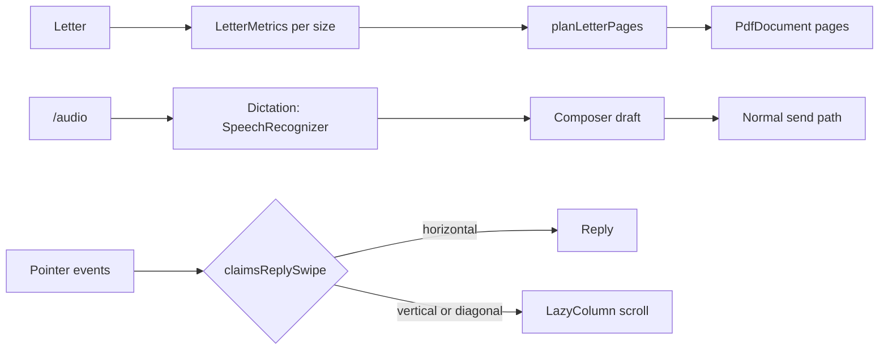

## Live presence (2026-10-19)

InternetTransport carries `{userId, online, lastSeenAt}` on the existing socket.
MessageService sends foreground state on visibility changes/reconnect and clears
partner state on disconnect/session teardown. The header prefers a snapshot,
retaining receipt fallback when none exists and own-network status priority.

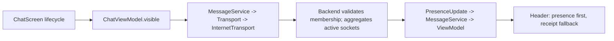

## A0 — implemented scaffold

Single app module, single exported Activity, Kotlin + Compose + Material 3,
Navigation Compose and Hilt. The only route is `welcome`; no auth, message,
push-token or call work is started. Incoming Activity extras are not consumed.
Firebase Messaging auto-init is disabled until A3. Backup is disabled because
later milestones store account/session/message state locally.

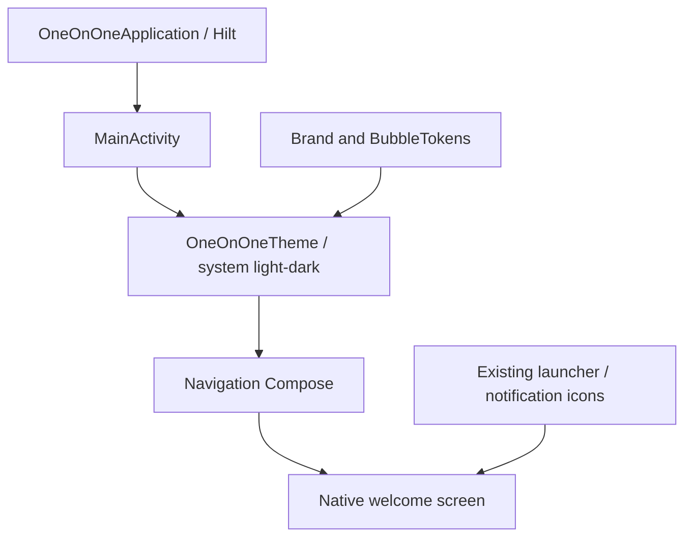

`ui/theme/BubbleTokens.kt` mirrors the entire web architecture token table dated
2026-10-07: dark, light, love and samurai; mine/other gradient stops, tails, text,
metadata, edges, sent ticks and read ticks. Wallpaper palettes apply in both
themes. Background gradients use 135 degrees when chat arrives in A2/A6.
The dark brand is green `#7ee787`, blue `#79c0ff`, background `#0d1117`;
system light mode uses readable green/blue accents without dynamic color.

## Required message boundary — planned for A2, not implemented in A0

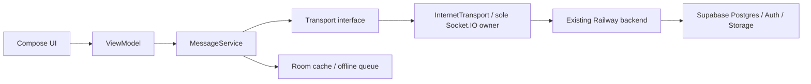

Every send, receive, reaction and call signal must stay behind the transport
boundary. REST repositories use Retrofit/OkHttp; Supabase Auth tokens authorize
REST and socket handshakes. The server validates identity, membership, status and
message payloads. Room is a cache, never an authorization source. A0 has no fake
repository, fake transport or backend implementation. No Bluetooth transport is
in scope.

## Build configuration and identity

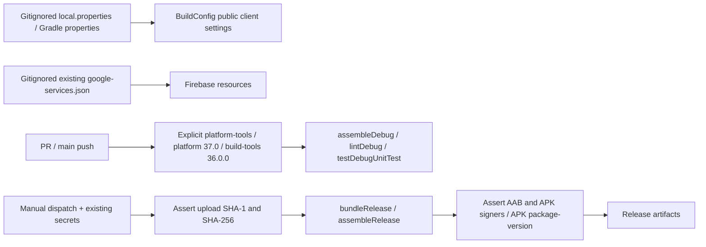

`app.web.oneonone`, minSdk 26, target/compile 37, versionCode 5 by default.
Signing is the unchanged upload identity; no key-generation path exists. Secret
files are scrubbed in CI. The API snapshot in this repo is copied verbatim from
the web repo; future changes must use the authoritative web contract, not infer
behavior from client code. No backend deployment or schema change is part of A0.

### A0 CI setup correction

Both debug and release jobs explicitly install platform-tools, platform 37.0
and build-tools 36.0.0. setup-android v3's default also asks for the removed
legacy `tools` package, so using its default fails before Gradle starts. The
explicit package list keeps the checks and release job on the same SDK/toolset.

## A1 — auth, gates and account state

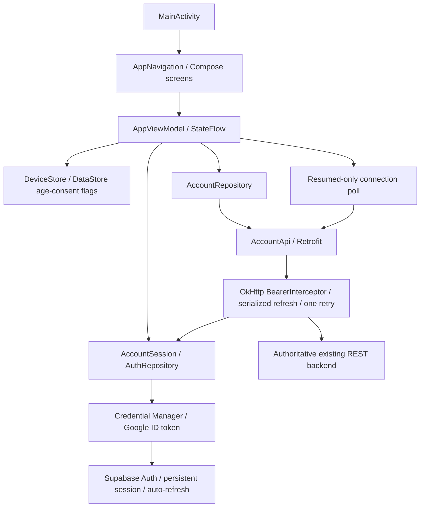

Navigation owns home, settings and blocked accounts. Home reflects a single
server-derived boot route; the age/consent gate comes before account screens.
On sign-out, protected back-stack screens are discarded. Date of birth is used
only in the UI; DataStore saves age verification and acceptance time, matching
the web's per-device rules. Connection state is not persisted as authorization.

Small AccountSession/DeviceStore interfaces allow JVM ViewModel/repository tests
without a Credential Manager/Android storage runtime. Supabase SDK session storage
and auto-refresh are reused; there is no custom token store. The interceptor runs
on OkHttp workers, never the main thread, and serializes only rejected-token
refreshes. An old request cannot invalidate a newer signed-in session. Push token
storage/unregister is wired now; actual registration and lifecycle arrive in A3.

This milestone consumes only the contract's me/current/request/accept/decline/
cancel/blocks/unregister/deletion routes. A2 will replace the chat placeholder and
introduce the frozen RealtimeSocket and rendering/call-launch seams, superseding
the old A0 diagram's sole-socket-owner label with RealtimeSocket.

## A2 — chat, durable queue and frozen realtime seam

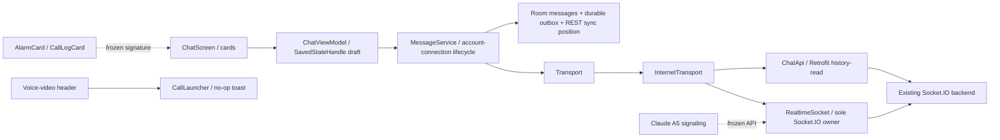

The A0 diagram's socket ownership label is superseded: only RealtimeSocket creates
Socket.IO, InternetTransport consumes it, and every message path remains behind
MessageService/Transport. A singleton application IO scope owns the active
conversation; per-conversation supervised collectors are cancelled and joined on
change/sign-out. The socket stays connected in background until teardown; the UI's
resumed-chat flag controls mark-read (A3 will also use it for notification suppression).
Call consumers share the same singleton rather than creating another socket.

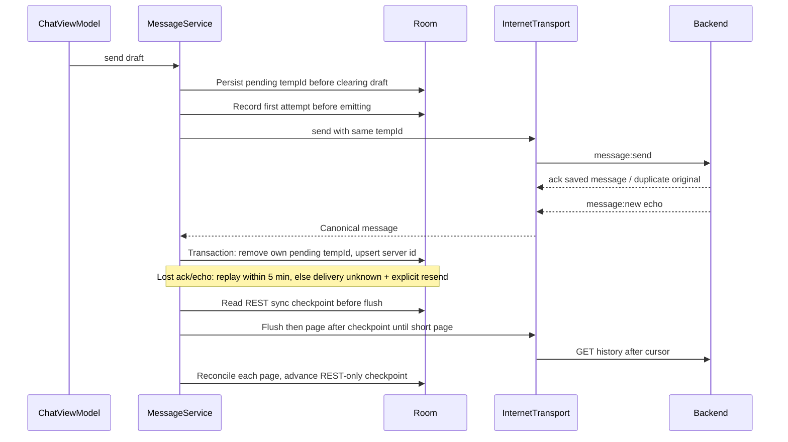

Room v1 has composite owner/connection/message keys and a separately persisted
REST watermark. Incoming/ack timestamps never advance it; otherwise an ack during
reconnect could skip missing older messages. Server timestamps are normalized to
fixed-width UTC only for SQLite sort columns; message bodies preserve wire values.
History replaces reactions authoritatively; a delayed tempId ack preserves newer
cached reaction changes. Room/cache/receipt flags do not grant membership.

Frozen public APIs and exact placeholder file ownership are listed in PROGRESS.
Claude may replace the CallLauncher binding and both cards, and add A4/A5 lifecycle
consumers without changing the message pipeline or opening another socket.

## A3 — data-only push and background work

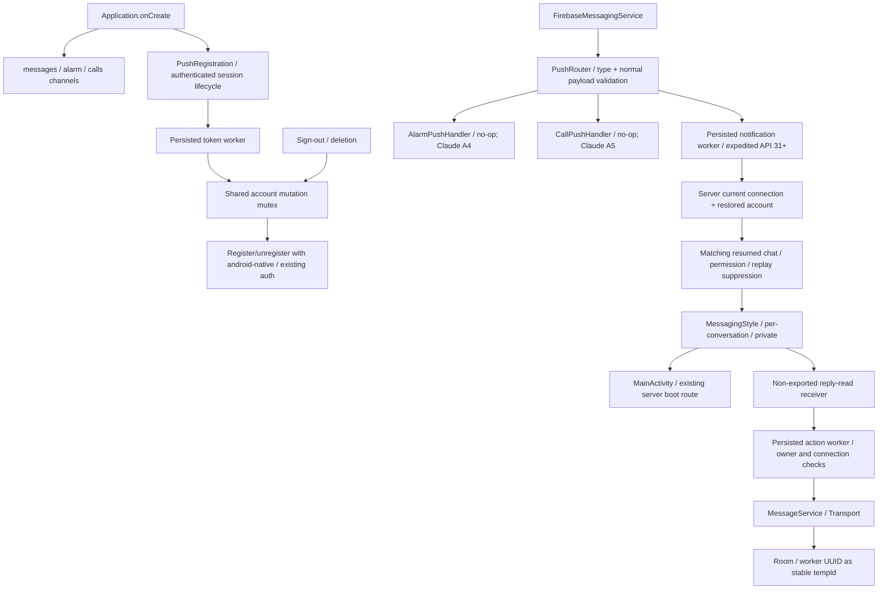

FCM callbacks do no slow network work; WorkManager keeps token/notification/action
work alive across process loss. API 31+ notification jobs are expedited; older APIs
use normal work without introducing an A3 foreground service. Server membership is
checked before posting/action execution. A delayed push cannot target a different
current conversation, and notification actions name a captured auth subject as well
as the conversation. MainActivity consumes no untrusted push authorization extras.

Reply work uses its immutable WorkRequest UUID as tempId. Enqueue first checks the
scoped Room alias; REST history preserves that alias on a canonical row, so worker
retries recognize already-acknowledged sends. The A2 five-minute uncertainty policy
still applies. Registration stores a candidate before HTTP and shares a mutex with
sign-out; in-flight registration finishes before token cleanup/session removal.

The three handler methods and exact PushHandlersModule path are frozen for Claude.
Message notifications never invoke an alarm or call implementation. The existing
notification-block missed-call fallback remains a generic no-action notice.
Proprietary OEM activities are unverified best-effort entry points with native
Settings/App info fallback; optional permission settings never gate account/chat use.

## A6 — structured features, private media and export

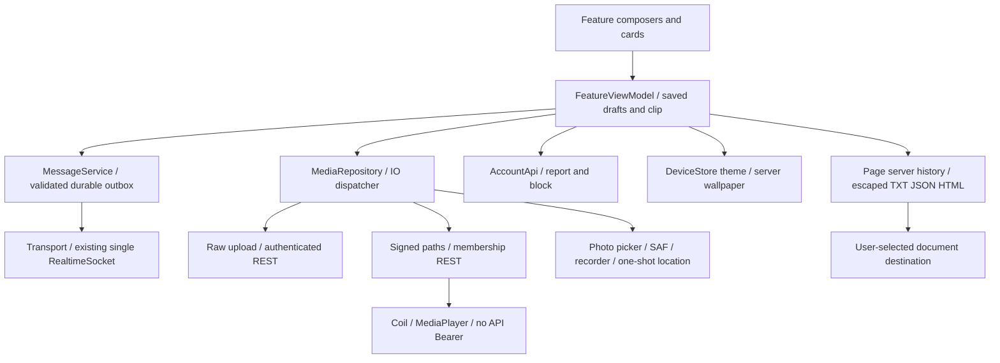

Structured features reuse ordinary immutable messages and replyTo rather than a
second state protocol. Contract validators run before Room enqueue. Ask/pick reply
attribution follows the original author. Alarm and call rendering/entry/push seams
remain frozen for Claude. No second socket or transport is constructed.

Media ownership is the current app user and connection; uploads and location
re-check that scope after asynchronous work. Completed voice clips survive config
changes/process restoration in private cache, while live recording and playback
stop at background/navigation. FileProvider exposes only `cache/shared`, never the
cache root or arbitrary paths. Unauthenticated media/map clients do not carry REST
credentials. Signed paths are server-authorized; storage URLs require HTTPS and the
configured Supabase host. Static photos strip EXIF by pixel re-encoding with a 4 MP
memory ceiling. Voice uses media audio focus and leaves call routing/mode alone.

Coil's official GIF/cache-control extensions share the pinned Coil version. The
custom client identifies the app for OSM and honors HTTP caching. Map tiles are
requested only when their cards are composed; no offline maps or tile prefetch.
Themes are per-device, wallpapers shared, and legacy line style renders bubbles
as the reference currently does. Export pages existing REST history and escapes
all HTML content; it includes attachment metadata rather than permanent media URLs.

## A7 — shrinker and release gates

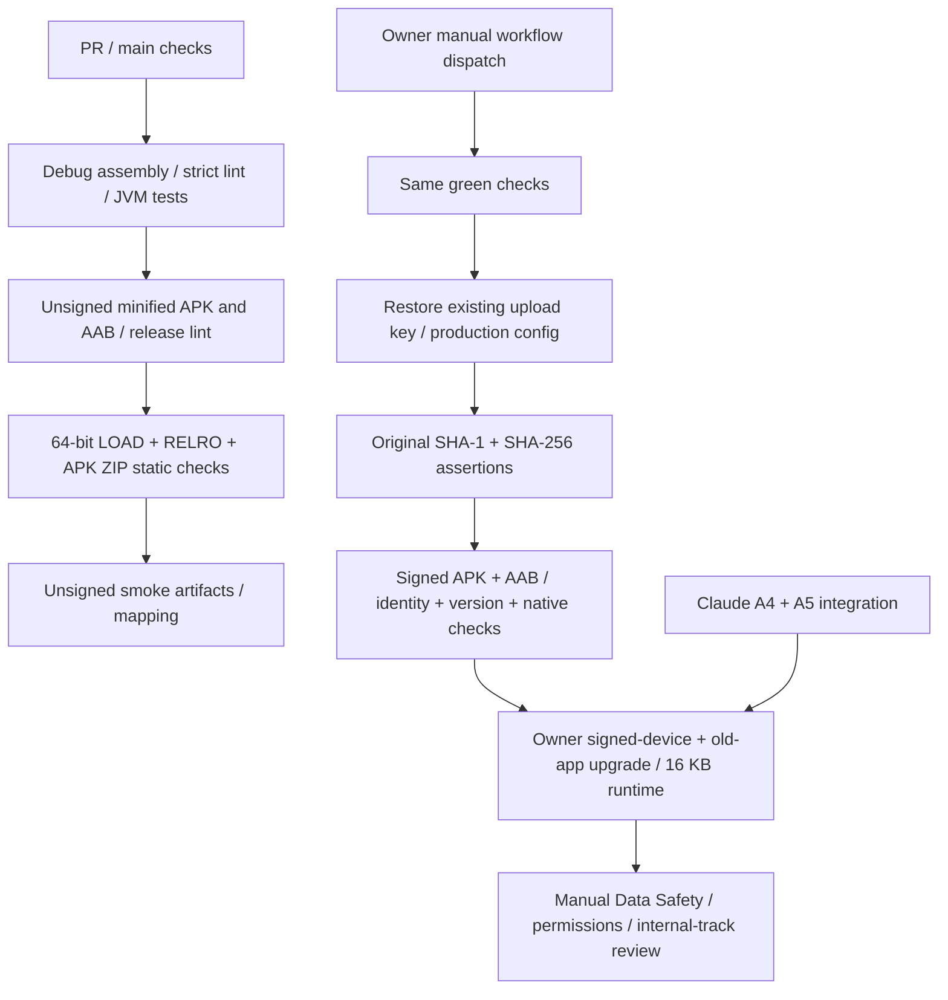

R8 keeps dynamic protocol/engine and WebRTC JNI boundaries with consumer rules
for Android/framework DI/serialization/database/background work. Two exact Ktor
JMX warnings are excluded because the pinned detector catches their absence on
Android; all other unresolved dependencies fail the build. Mapping is retained.
Resource shrinking and dependency ART profiles are enabled without claiming a
measured app baseline profile or authenticated runtime verification.

The native checker examines actual ELF64 headers for arm64-v8a/x86_64 in APK/AAB
and verifies stored APK entry offsets. RELRO is checked against writable segment
ranges rather than rejecting safe whole-LOAD endpoints solely for a nonzero
modulo. This static evidence doesn't replace a final 16 KB runtime test. See the
[Android linker source](https://android.googlesource.com/platform/bionic/+/main/linker/linker_phdr.cpp)
and [page-size guidance](https://developer.android.com/guide/practices/page-sizes).

Unsigned smoke artifacts and any local debug-signed minified copy are separate
from manual CI's real upload-key artifacts. Signed CI still verifies the original
certificate and Firebase/package/version assertions; it never uploads to Play.
Final release requires Claude's reserved features plus owner phone/Console gates.
The release checklist is a Data Safety draft grounded in current native behavior
and the web privacy/API references, with final SDK/provider/call review explicit.

## Emergency alarm (A4)

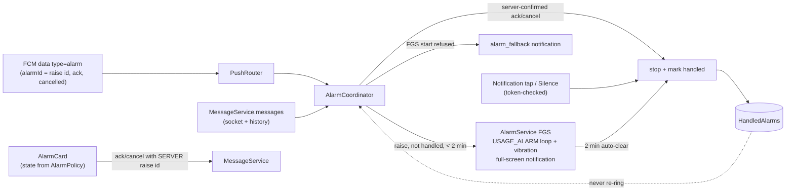

## Calls (A5)

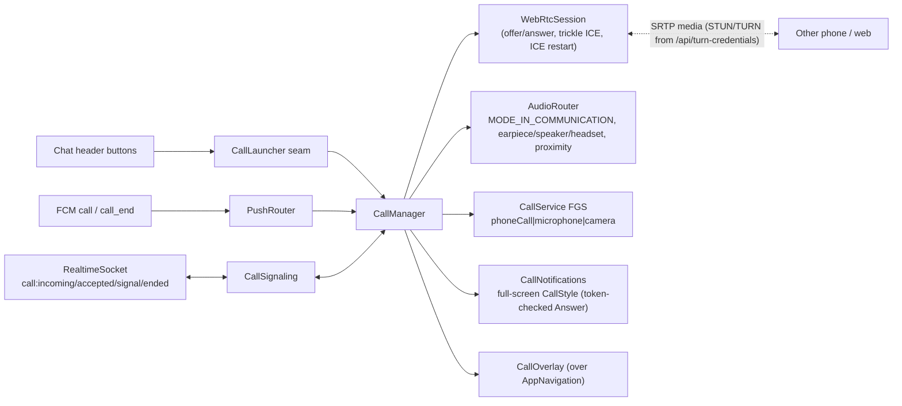


## Design system (S1)

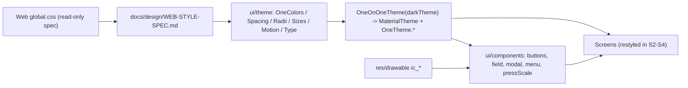


## Chat screen composition (S2)

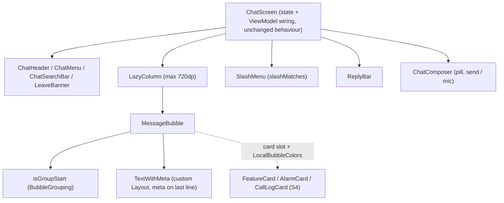

## Presence and launch (D2)

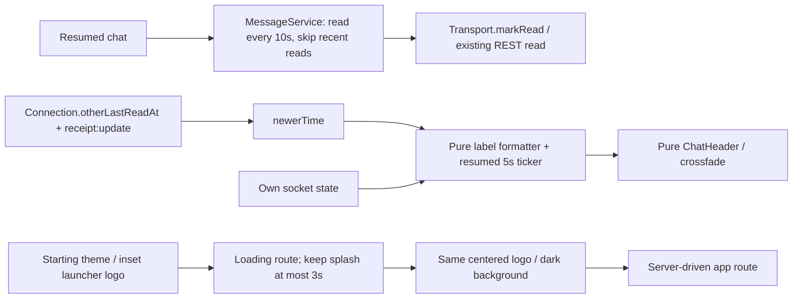

Presence uses the existing receipt timestamp, with a strict 15-second freshness
window; socket trouble overrides the other member's status. Immediate message
reads and tick rendering retain their existing behavior. Heartbeat freshness
uses monotonic time and stops when paused or deactivated. The loading screen
bypasses ScreenFrame's text, progress and entry animation for a seamless launch.

## Attachment cards and viewers (D3)

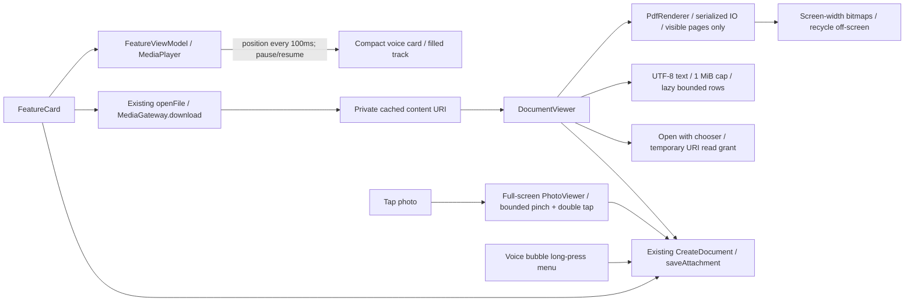

Viewer dialogs use a black surface and safe system-bar insets. PDF open/render/
close runs off the main thread; one mutex coordinates page access and disposal,
and closing the renderer also closes its descriptor. Only visible PDF rows own
bitmaps. Text reads at most 1 MiB plus one byte to detect truncation; lazy rows
also bound the layout work for very long lines. Voice cards register their save
callback with the containing bubble's existing menu, without adding ChatScreen
callbacks. No endpoint, payload, attachment authorization or cache boundary changes.
### Navigation routes (D4)

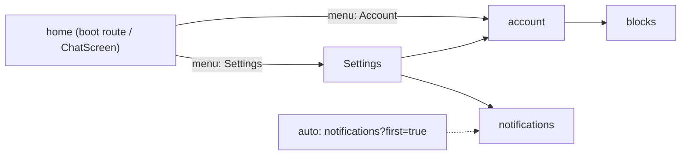

`settings`, `account`, `blocks` and `notifications` share `SettingsScaffold`.
Appearance/Export dialogs are hosted by the `settings` route (chat connection only).

### Chat scroll pinning and search (2.0.1)

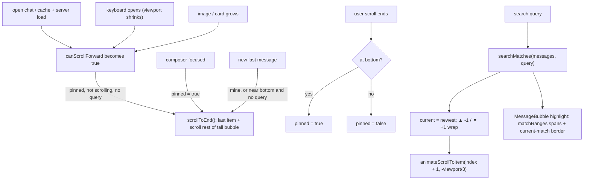

Search is client-side over loaded messages only; the full log stays visible.

### Pre-chat flow and gates (2.0.2)

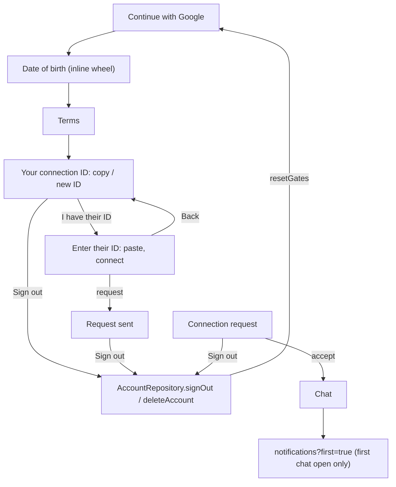

### Chat notices and alarm limit (2.0.2)

```mermaid
flowchart LR
  Raise["send alarm raise"] --> Recent{"own raise in last 3 min?"}
  Recent -->|yes| Refuse["IllegalStateException: wait notice"]
  Recent -->|no| Queue["outbox → InternetTransport"] --> Ack{"server ack"}
  Ack -->|rejected| Drop["store.discard + wait notice"]
  Ack -->|IOException| Queued["stays queued"]
  State["connectionState ≠ Connected for 2s"] --> Pill["top pill: No connection · Reconnecting…"]
  Errors["chat / feature / account error"] --> Toast["bottom pill, 4s"]
```

### Message gestures and selection (chat polish, 2026-10-14)

```mermaid
flowchart LR
    T[Tap] --> Q{Where?}
    Q -->|link / number| O[Open]
    Q -->|reply quote| J[Jump to original]
    Q -->|selection mode| S[Toggle selection]
    Q -->|elsewhere| X[Show timestamp]
    D[Double tap] --> R[ReactionBar popup<br/>not focusable] -->|reaction:add / remove| MS[MessageService]
    L[Long press] --> LQ{On link?}
    LQ -->|yes| C[Copy link / number]
    LQ -->|no| S
    S --> SB[SelectionBar: reply · copy · save · report]
```

### Emergency alarm in the open chat (2026-10-14)

```mermaid
sequenceDiagram
    participant FCM as FCM / socket
    participant AC as AlarmCoordinator
    participant AS as AlarmService
    participant UI as ChatScreen
    FCM->>AC: raise
    AC->>AS: ring (sound + full-screen)
    Note over UI: notification tap opens chat, ring continues
    UI->>UI: live raise from them: red glow + banner
    UI->>FCM: Acknowledge = alarm ack (contract)
    FCM-->>AC: server-confirmed ack
    AC->>AS: stop
```

### Edit / delete / pin / typing / link previews (2026-10-14)

```mermaid
flowchart LR
    UI[ChatScreen] --> VM[ChatViewModel] --> MS[MessageService] --> T[Transport] --> IT[InternetTransport]
    IT -- "message:edit / message:delete / message:pin / typing" --> S[(Socket.IO)]
    S -- "message:update" --> IT -->|reconcile| R[(Room cache)]
    S -- "pin:update / typing" --> IT --> MS
    IT -- "GET /api/link-preview" --> API[Backend unfurl<br/>SSRF-guarded]
    API -->|title + base64 image| MS -->|cached per URL| UI
```

### Alarm "Silence" = acknowledgment, message push delivered inline (2026-10-14, round 2)

```mermaid
sequenceDiagram
    participant FCM
    participant MS as OneOnOneMessagingService
    participant AC as AlarmCoordinator
    participant AS as AlarmService
    participant Svc as MessageService
    FCM->>MS: message push
    MS->>MS: deliverMessagePush (≤8 s, in the FCM window)
    MS-->>MS: on failure/timeout: MessageNotificationWorker (retry)
    FCM->>AC: alarm raise
    AC->>AS: ring (quiet channel if the chat is open: banner is the ack UI)
    AS-->>AC: FGS refused: insistent backup notification; full-screen tap promotes it to a real ring
    Note over AS: user taps Silence on the notification
    AS->>AC: silenced(alarmId) → HandledAlarms.pendingAcks
    AC->>Svc: send alarm {ack} (temp id silence-<id>) once a chat session is active and the raise is still Live
```

### GIPHY GIFs and profile photos (2026-10-14)

```mermaid
flowchart LR
    Sheet[ComposerEmojiSheet · GIFs] --> FVM[FeatureViewModel] --> MG[MediaRepository]
    MG -- "GET /api/gifs" --> BE[Backend gifService] -- "API key (server env)" --> G[(GIPHY API)]
    MG -- "POST /connections/:id/gifs {id}" --> BE -- "fetch *.giphy.com, GIF magic, ≤10 MiB" --> ST[(private attachments bucket)]
    BE -->|"{path, mime, size, width, height}"| MG --> MS[MessageService.send type=image]
    Settings[Settings · Your photo] --> PVM[ProfileViewModel] -- "PUT/DELETE /api/me/avatar" --> BE2[avatarService] --> ST
    PVM -- "GET /api/me/avatars (yours + live partner only)" --> BE2
    Header[ChatHeader] -->|"PartnerPhoto (device-only) → otherAvatar → initial"| PVM
```

### Sticker maker and account library (2026-10-14, Prompt 1)

The third composer tab uses the existing theme and inherits ProvideChatTextScale.
PickVisualMedia supplies a content URI; StickerViewModel retains the URI permission,
mode and normalized crop in SavedStateHandle. Decode applies the existing EXIF
orientation helper and bounds the longer side to 1024 px. CPU segmentation,
pixel re-encoding and file/index work run off the main thread. A missed subject or
segmenter failure keeps Original available and explains the fallback.
MediaPipe owns a private input bitmap copy; closing MPImage cannot recycle the
Original bitmap still displayed by the maker.

```mermaid
flowchart LR
    Sheet[ComposerEmojiSheet · Stickers] --> SVM[StickerViewModel / saved URI-mode-crop]
    SVM --> Picker[PickVisualMedia / private bounded pixels]
    Picker --> Segment[MediaPipe CPU / bundled DeepLab-v3]
    Segment --> Crop[Original or Cut-out / normalized square crop]
    Crop --> WebP[512×512 alpha WebP / quality 100 to 80 / ≤100000 bytes]
    SVM --> Library[StickerLibrary / atomic JSON and WebP files]
    Library --> Files[filesDir/stickers/ownerId]
    Account[AccountRepository sign-out or deletion] --> Lock[Shared AccountMutationLock]
    SVM --> Lock
    Lock --> Clear[Clear index and files before removing credentials]
    Sheet --> FVM[FeatureViewModel.sendSticker]
    FVM --> Media[MediaGateway.uploadSticker / raw image-webp attachment]
    FVM --> MS[MessageService / normal image payload and replyTo]
    MS --> Transport --> InternetTransport
```

The JSON index contains id, createdAt, lastUsedAt, favourite, a display title and
an optional local pack name. Favourites and My stickers sort newest first; Recent
contains the last 16 used, with deterministic ties. One original six-vector pack,
Little signals, is rendered to WebP on an account's first library load. Deleting a
built-in is persistent because an existing empty index is never reseeded. Account
mutations and library edits share the same lock, with signed-in owner checks, so a
late save cannot recreate files after sign-out. Cleanup follows successful push
unregistration or successful server account deletion; failed requests preserve data.
Malformed indexes are reported without overwriting them.
Indexes have a 1 MiB ceiling, checked before writing; approaching a few thousand
stickers would justify replacing JSON with Room.

Sticker uploads validate the private file scope, WebP format, 512×512 dimensions,
100000-byte cap and server response. The attachment endpoint and message payload
remain exactly contract §2/§4: type image, {path, mime, size, width, height}.
The ordinary photo uploader still strips EXIF; the already-encoded sticker File
path preserves alpha. Received images and delete-for-everyone use existing behavior.

#### Background-removal choice, licence and attribution

Decision: the only added dependency is com.google.mediapipe:tasks-vision:1.1.0,
using the bundled float32 DeepLab-v3 v1 model on CPU. First-use segmentation works
without Play services or a model download. No photo is sent for segmentation.
This accepts a larger APK to meet the strict offline requirement.

| Comparison | MediaPipe Image Segmenter + DeepLab-v3 | ML Kit Subject Segmentation |
| --- | --- | --- |
| People | Person is a supported category. The 257×257 confidence mask is enlarged with filtered soft alpha; fine hair needs device review. | Designed to isolate prominent people, including multiple subjects and separate subject masks. |
| Pets | The bundled labels include cat, dog, bird, cow, horse and sheep. Fur and small subjects need device review. | Designed for prominent pets as well as people. |
| Objects | Fixed VOC categories such as bottle, chair, vehicle and plant; unrecognized objects may need Original. | Designed for prominent objects, without this app's fixed VOC label filter. |
| Licence | SDK and TensorFlow model: Apache-2.0; attribution and licence bundled below. | Google APIs Terms of Service plus ML Kit terms; models are related software under those terms. |
| Size and availability | Model: 2,780,176 bytes plus SDK native libraries; actual universal debug APK delta is in PROGRESS. | Google's documented app increase is about 200 KB; its model must first be downloaded through Play services. Inference is local afterward. |

This is a comparison of documented capabilities and expected limitations, not a
measured head-to-head quality result. People, pet fur and object edge quality on
Xiaomi hardware remain in the device checklist.

Sources: [MediaPipe models and categories](https://ai.google.dev/edge/mediapipe/solutions/vision/image_segmenter),
[Android execution guide](https://ai.google.dev/edge/mediapipe/solutions/vision/image_segmenter/android),
[TensorFlow model catalogue and licence](https://www.kaggle.com/models/tensorflow/deeplabv3),
[MediaPipe licence](https://github.com/google-ai-edge/mediapipe/blob/master/LICENSE),
[ML Kit subject capabilities](https://developers.google.com/ml-kit/vision/subject-segmentation),
[ML Kit installation and size](https://developers.google.com/ml-kit/vision/subject-segmentation/android),
[ML Kit terms](https://developers.google.com/ml-kit/terms).

Attribution: MediaPipe Authors and TensorFlow Authors. The pinned model is
[DeepLab-v3 float32 v1](https://storage.googleapis.com/mediapipe-models/image_segmenter/deeplab_v3/float32/1/deeplab_v3.tflite),
SHA-256 ff36e24d40547fe9e645e2f4e8745d1876d6e38b332d39a82f0bf0f5d1d561b3.
The APK includes stickers/APACHE-2.0.txt and stickers/NOTICE.txt alongside the model.
Little signals' love, star, wave, cat, sprout and moon paths were drawn specifically
for this change; no third-party artwork is used.

[WhatsApp/stickers](https://github.com/WhatsApp/stickers) was reviewed as a
third-party pack-app reference under its
[BSD-3-Clause licence](https://github.com/WhatsApp/stickers/blob/main/LICENSE).
Only the square 512 px and small WebP sizing concepts informed this in-app library.
Its 96 px tray icon is a WhatsApp pack-provider convention and is not needed here.
No WhatsApp code, artwork, content provider or integration is included.

## Sticker/photo rendering and instant media sends (2026-10-14, 2.0.4)

Built-in packs: Little signals and Cats (original vector drawings, rendered to WebP on first
library creation) and Craftwork "Open Stickers" IT / Life / Nature / Shapes (owner holds a paid
Craftwork licence; pre-encoded 512×512 WebP in `assets/stickers/packs`, copied as-is).
Maker gains a free crop box (`StickerTrim`) applied before the square placement (`StickerCrop`).

```mermaid
flowchart LR
  Tap[Sticker tap / voice stop / GIF tap] --> P[FeatureViewModel.pending += item]
  P --> UI[ChatScreen: PendingMediaBubble at list end]
  P --> Up[MediaGateway upload]
  Up --> Send[MessageService.send -> Transport -> InternetTransport]
  Send --> Done[pending -= item; real message replaces the placeholder]
```

```mermaid
flowchart TD
  M[image message] --> S{512x512 image/webp and no reply quote?}
  S -- yes --> St[Bare sticker 150dp + bubble-coloured time pill under its corner]
  S -- no --> Ph[Photo in a 3dp bubble frame + time/ticks scrim on the image]
  St --> Side{mine?}
  Ph --> Side
  Side -- yes --> R[bottom-right]
  Side -- no --> L[bottom-left]
```

Stickers are still ordinary `image` payloads (contract unchanged); detection by exact
512×512 WebP is a client shortcut until the optional backend sticker flag (codex Prompt 2).
All chat times use a 12-hour `h:mm a` clock in the device time zone.

## Owner feedback round (2026-10-19, 2.0.5)

Age/Terms gates are local device prefs keyed to the auth user (`gatesOwner` = JWT `sub`).
Sign-out keeps them, so the same account goes straight to the chat; another account, or a
deleted and re-created one, is asked again. Gates saved before this change are adopted by the
signed-in user on first read (sign-out used to wipe them, so they can only be theirs).

```mermaid
flowchart TD
  L[AppViewModel.load] --> T[auth.accessToken -> tokenSubject]
  T --> G{DeviceStore.gates owner matches?}
  G -- yes, both set --> C[me + current connection -> Chat]
  G -- no / missing --> A[Age -> Consent, saved with owner]
  SO[signOut] -. keeps gates .-> G
  DA[deleteAccount] -. resetGates .-> G
```

Letters render as one white A4-proportioned page in black Dancing Script (OFL, `res/font`),
date top-right, body indented, signature pinned to the page foot. "Download PDF" draws the
same layout with `PdfDocument` + `StaticLayout` (`writeLetterPdf`), breaking long letters
line by line across A4 pages. The payload still carries `appearance: "dawn"` (contract).

```mermaid
flowchart LR
  V[LetterViewer Download PDF] --> CD[CreateDocument application/pdf]
  CD --> VM[FeatureViewModel.saveLetter]
  VM --> MG[MediaGateway.saveLetterPdf, IO]
  MG --> W[writeLetterPdf: A4 pages, handwriting Typeface]
```

Selection inside cards: photo, file row and card buttons swallow the bubble's long press, so
they use `bubbleClickable` (LocalMessageSelection): long press selects the message (enables
Delete within the server's 30-minute window), taps toggle while selecting.

Incoming call: a ring posted while the app was backgrounded is replaced by a silent copy
(`CallNotifications.quietIncoming`) when the in-app ring starts, so only one ringtone plays.
Alarm: a queued ack from this device stops the local ring immediately (`AlarmPolicy.ownAcks`)
instead of after the server echo. Presence ages a live receipt by the phone's monotonic clock
(immune to server/phone clock skew) and ticks every second; truly instant online/offline needs
the backend `presence` socket event (see the [backend handoff prompt](prompts/backend-presence-prompt.md)).
This is a proposal, not the current API contract. Backend support and Android event
emission/subscription are still pending; the receipt-based fallback remains in use.
